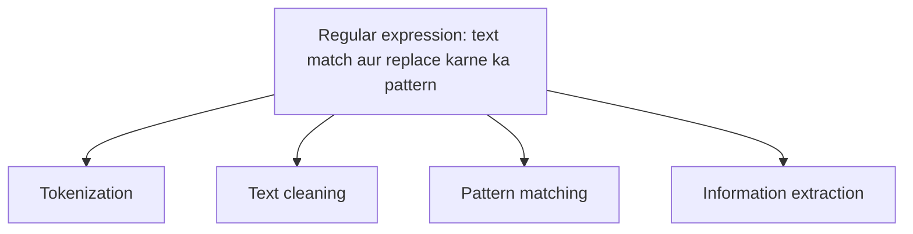

**In simple words:** regular expression ek chhota pattern hai jo text dhundta ya badalta hai, isliye text clean karne aur todne ka pehla tool yahi hai.

**Definition:** a regular expression is a pattern used to match and replace text. <Cite id="class-nlp-m2" loc="p. 18" />

**Uses:** text clean karna; words, numbers, emails, dates dhundna; unwanted symbols hataana. <Cite id="class-nlp-m2" loc="p. 18" />

| Kaam | Matlab | Teacher ka example |
|---|---|---|
| Tokenization | Sentences ko words ya tokens mein todna | NLP is fun se "NLP", "is", "fun" |
| Text cleaning | Punctuation, html tags, hashtags jaise unwanted characters hataana | NLP@2026 is easy se NLP2026 is easy |
| Pattern matching | Text ke andar similar patterns, shapes aur rules dhundna | "my age is 20", "her age is 18": pattern hai age is Number |
| Information extraction | Bade data se useful information dhundna | Google search |

<Cite id="class-nlp-m2" loc="p. 18" /> <Cite id="class-nlp-m2" loc="p. 19" />

**Significance:** regular expressions chhote, fast aur exact hote hain, isliye kisi model se pehle text taiyaar karte hain aur dates, emails aur numbers nikaalte hain. Standard patterns (class files mein nahi): `[0-9]+` numbers dhundta hai, `\w+` words.

**Conclusion:** regular expressions wo pattern tool hain jo tokenizing, cleaning, matching aur extracting ke peeche hai.
