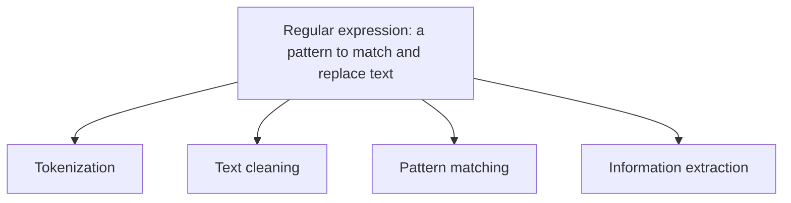

**In simple words:** a regular expression is a small pattern that finds or changes text, so it is the first tool used to clean and split text.

**Definition:** a regular expression is a pattern used to match and replace text. <Cite id="class-nlp-m2" loc="p. 18" />

**Uses:** clean the text; find words, numbers, emails, dates; remove unwanted symbols. <Cite id="class-nlp-m2" loc="p. 18" />

| Job | Meaning | Teacher's example |
|---|---|---|
| Tokenization | Splitting sentences into words or tokens | NLP is fun gives "NLP", "is", "fun" |
| Text cleaning | Removing unwanted characters like punctuation, html tags, hashtags | NLP@2026 is easy gives NLP2026 is easy |
| Pattern matching | Finding similar patterns, shapes and rules inside the text | "my age is 20", "her age is 18": the pattern is age is Number |
| Information extraction | Finding useful information from a large amount of data | Google search |

<Cite id="class-nlp-m2" loc="p. 18" /> <Cite id="class-nlp-m2" loc="p. 19" />

**Significance:** regular expressions are small, fast and exact, so they prepare text before any model is used and pull out dates, emails and numbers. Standard patterns (not in the class files): `[0-9]+` finds numbers, `\w+` finds words.

**Conclusion:** regular expressions are the pattern tool behind tokenizing, cleaning, matching and extracting.
