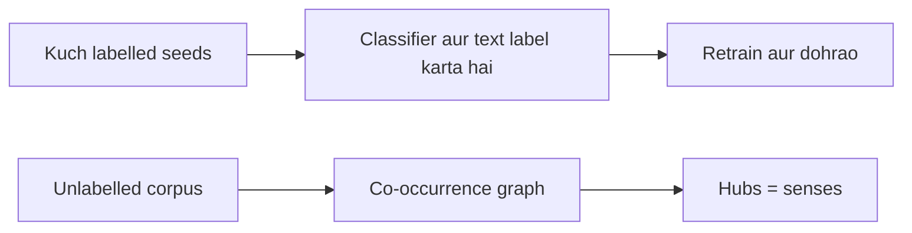

**In simple words:** semi-supervised WSD thode labelled examples se shuru hota hai (Yarowsky); unsupervised WSD mein koi labelled example nahi hota (Hyperlex).

**Semi-supervised method (Yarowsky)** <Cite id="class-nlp-pyq4" loc="p. 7" />

Yarowsky algorithm ek iterative bootstrapping method hai jo chhote labelled seed set se bahut saare unlabelled data ko classify karta hai. Ye do principles par tikta hai: one sense per collocation (kisi aas-paas ke word ke saath word ka sense wahi rehta hai) aur one sense per discourse (document mein word ek sense rakhta hai). <Cite id="class-nlp-pyq4" loc="p. 7" />

Steps: seed examples, decision list train karo, confident predictions se unlabelled text label karo, one sense per discourse lagao, naye labels jodkar retrain karo, jab tak kuch naya label na ho dohrao. <Cite id="class-nlp-pyq4" loc="p. 7" /> <Cite id="class-nlp-pyq4" loc="p. 8" />

**Unsupervised method (Hyperlex)**

*(Class files mein Hyperlex nahi hai; ye standard short explanation hai.)* Hyperlex ko na labelled data chahiye na senses ki dictionary. Ye text corpus se ek graph banata hai:

1. Target word ke paas aane wale words lo; har ek ek node hai.
2. Do nodes ko jodo agar wo aksar saath aate hain (co-occurrence graph).
3. **Hubs** dhundho: sabse zyaada jude hue nodes. Har hub target word ke ek sense ko dikhata hai.
4. Naye sentence ke liye dekho uske context words kis hub ke sabse paas hain, aur target word ko wahi sense do.

| Point | Yarowsky | Hyperlex |
|---|---|---|
| Labelled data | Chhota seed set | Koi nahi |
| Idea | Do principles ke saath bootstrapping | Word graph ke hubs |
| Weakness | Kharab seeds errors failate hain | Mile senses dictionary se match na bhi karein |

**Conclusion:** Yarowsky seeds se labels badhata hai; Hyperlex sirf text ke structure se senses dhundhta hai.
