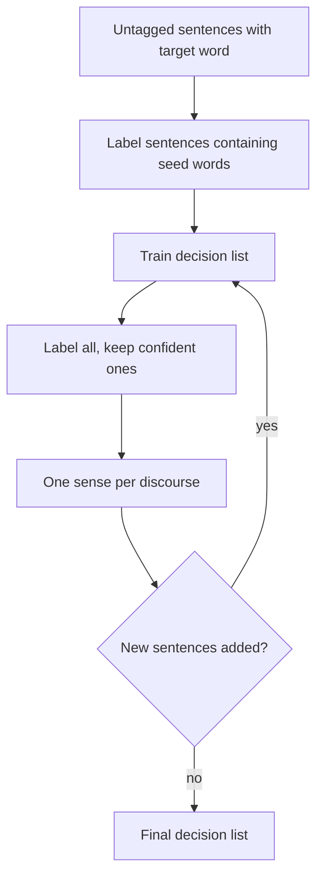

**In simple words:** dono methods bade hand-tagged corpus ke bina word ka sense dhundte hain. **Semi-supervised** (Yarowsky) kuch tagged seeds se shuru hota hai. **Unsupervised** (HyperLex) mein koi tag nahi hota aur senses khud dhoondhe jaate hain. <Cite id="word-sense-disambiguation-gfg-wsd" /> <Cite id="ambiguity-challenges-navigli2009" loc="§3.8.1" />

**1) Yarowsky ka semi-supervised method (1995).** Ye do rules pe tika hai: **one sense per collocation** (paas ke words strong aur steady clue dete hain) aur **one sense per discourse** (ek document mein word ka ek hi sense rehta hai). <Cite id="word-sense-disambiguation-yarowsky1995" />

1. Raw text se target word (jaise *plant*) wale saare sentences jama karo.
2. Har sense ke liye haath se ek **seed word** do: *life* (living) aur *manufacturing* (factory). Seed wale sentences ko wo label milta hai.
3. In labelled sentences pe **decision list** train karo. Wo naye clues seekhti hai, jaise *species* aur *worker*.
4. Decision list se saare sentences label karo aur sirf confident wale rakho.
5. One sense per discourse lagao taaki har document consistent ho.
6. Steps 3 se 5 dohrao jab tak kuch naya na judey.

<Cite id="word-sense-disambiguation-wiki-yarowsky" loc="diagram" />

*Advantage:* sirf seeds aur raw text chahiye. *Disadvantage:* shuru ka galat label phail sakta hai.

**2) HyperLex (Véronis, 2004), unsupervised.** Senses **co-occurrence graph** se milte hain. <Cite id="ambiguity-challenges-navigli2009" loc="§4.3" />

1. Graph banao: words nodes hain; do words jude hote hain agar ek paragraph mein target ke saath aate hain.
2. Har edge ka weight $w_{ij} = 1 - \max\{P(w_i \mid w_j),\ P(w_j \mid w_i)\}$. Jo words aksar saath aate hain unka weight 0 ke paas (close) hota hai.
3. Sabse zyada connected nodes ko **hubs** chuno. Har hub ek sense hai.
4. Hubs ko target se jodo aur minimum spanning tree nikalo.
5. Naye sentence mein har context word ka nearest hub dhundo, score $1/(1+d)$, jodo, aur sabse bada hub lo.

| Point | Yarowsky | HyperLex |
|---|---|---|
| Type | Semi-supervised | Unsupervised |
| Needs | Kuch seed words | Sirf raw text |
| Senses kahan se | Seeds se fixed | Hubs ki tarah discover |
| Output | Named senses | Unnamed senses (hubs) |

**Conclusion:** Yarowsky seeds se labelled set badhata hai; HyperLex senses ko word graph ke hubs ki tarah discover karta hai.

Exam mein English mein likho: "Yarowsky bootstraps from seed words using one sense per collocation and per discourse; HyperLex finds senses as hubs of a co-occurrence graph."
