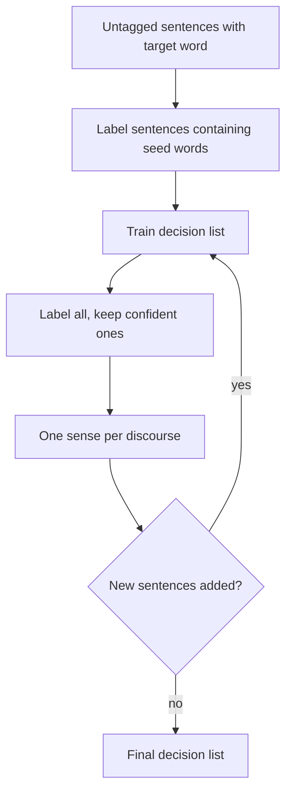

**In simple words:** both methods find the sense of a word without a large hand-tagged corpus. **Semi-supervised** (Yarowsky) starts from a few tagged seeds. **Unsupervised** (HyperLex) uses no tags at all and finds the senses by itself. <Cite id="word-sense-disambiguation-gfg-wsd" /> <Cite id="ambiguity-challenges-navigli2009" loc="§3.8.1" />

**1) Yarowsky's semi-supervised method (1995).** It rests on two rules: **one sense per collocation** (nearby words give a strong, steady clue) and **one sense per discourse** (in one document a word keeps one sense). <Cite id="word-sense-disambiguation-yarowsky1995" />

1. Collect all sentences with the target word (for *plant*) from raw text.
2. Give one **seed word** per sense by hand: *life* (living) and *manufacturing* (factory). Sentences with a seed get that label.
3. Train a **decision list** on these labelled sentences. It learns new clues, such as *species* and *worker*.
4. Label all sentences with the list and keep only the confident ones.
5. Apply one sense per discourse to make each document consistent.
6. Repeat steps 3 to 5 until nothing new is added.

<Cite id="word-sense-disambiguation-wiki-yarowsky" loc="diagram" />

*Advantage:* needs only seeds and raw text. *Disadvantage:* an early wrong label can spread.

**2) HyperLex (Véronis, 2004), unsupervised.** Senses are found from a **co-occurrence graph**. <Cite id="ambiguity-challenges-navigli2009" loc="§4.3" />

1. Build a graph: words are nodes; two words are joined if they occur together in a paragraph with the target.
2. Weight each edge $w_{ij} = 1 - \max\{P(w_i \mid w_j),\ P(w_j \mid w_i)\}$. Words that often occur together get a weight near 0 (close).
3. Pick the best-connected nodes as **hubs**. Each hub is one sense.
4. Join the hubs to the target and find the minimum spanning tree.
5. For a new sentence, find the hub nearest to each context word, score $1/(1+d)$, add up, and take the highest hub.

| Point | Yarowsky | HyperLex |
|---|---|---|
| Type | Semi-supervised | Unsupervised |
| Needs | A few seed words | Only raw text |
| Senses come from | Fixed by the seeds | Discovered as hubs |
| Output | Named senses | Unnamed senses (hubs) |

**Conclusion:** Yarowsky grows a labelled set from seeds; HyperLex discovers senses as hubs in a word graph.
