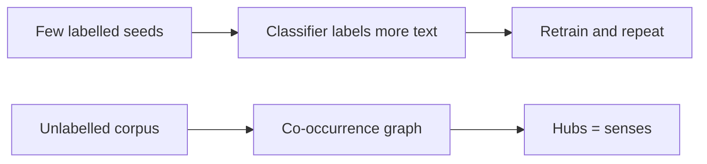

**In simple words:** semi-supervised WSD starts from a few labelled examples (Yarowsky); unsupervised WSD uses no labelled examples at all (Hyperlex).

**Semi-supervised method (Yarowsky)** <Cite id="class-nlp-pyq4" loc="p. 7" />

The Yarowsky algorithm is an iterative bootstrapping method that uses a small set of labelled seed examples to classify a large amount of unlabelled data. It relies on two principles: one sense per collocation (a word with a given nearby word keeps the same sense) and one sense per discourse (a word keeps one sense in a document). <Cite id="class-nlp-pyq4" loc="p. 7" />

Steps: seed examples, train a decision list, label the unlabelled text with confident predictions, apply one sense per discourse, add the new labels and retrain, repeat until nothing new is labelled. <Cite id="class-nlp-pyq4" loc="p. 7" /> <Cite id="class-nlp-pyq4" loc="p. 8" />

**Unsupervised method (Hyperlex)**

*(The class files do not cover Hyperlex; this is the standard short explanation.)* Hyperlex needs no labelled data and no dictionary of senses. It builds a graph from a text corpus:

1. Take the words that appear near the target word; each is a node.
2. Join two nodes if they occur together often (a co-occurrence graph).
3. Find the **hubs**: the most highly connected nodes. Each hub stands for one sense of the target word.
4. For a new sentence, see which hub its context words are closest to, and give the target word that sense.

| Point | Yarowsky | Hyperlex |
|---|---|---|
| Labelled data | Small seed set | None |
| Idea | Bootstrapping with two principles | Hubs in a word graph |
| Weakness | Poor seeds spread errors | Senses found may not match a dictionary |

**Conclusion:** Yarowsky grows labels from seeds; Hyperlex finds senses from the structure of the text alone.
