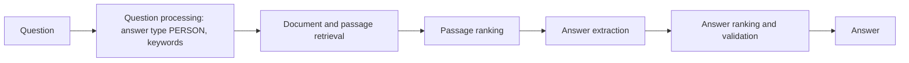

**In simple words:** **question answering (QA) system** natural language mein sawaal leta hai aur chhota, seedha answer deta hai, documents ki list nahi. Example: "Who invented the telephone?" ka answer "Alexander Graham Bell". <Cite id="ambiguity-challenges-wiki-qa" /> <Cite id="pyq-2024-12-ibm-qa" />

**Kyun:** log answer chahte hain, das pages padhna nahi. QA voice assistants, bank bots aur search ke answer boxes chalata hai.

**Types:** *factoid* (who, when, where) aur *non-factoid* (why, how); *closed-domain* aur *open-domain*; *extractive* (answer text se copy) aur *generative* (answer naya likha).

**Algorithmic approach (IR-based QA)**

<Cite id="nlp-applications-slp3-11" loc="diagram" />

1. **Question processing:** wh-word se **expected answer type** nikalo (who se PERSON, when se DATE, where se LOCATION, how many se NUMBER). Stop words hatakar content words (*invented, telephone*) se query banao.
2. **Document retrieval:** IR engine query ke top documents deta hai.
3. **Passage ranking:** documents ko passages mein todo aur jinme query words paas-paas zyada hon wo rakho.
4. **Answer extraction:** passages mein expected type ki strings dhundo (named entity recognizer se), ya neural reader answer span mark kare, jaise SQuAD pe train hota hai. <Cite id="nlp-applications-squad" />
5. **Answer ranking aur validation:** candidates ko keywords se closeness aur passages mein kitni baar aaye us se score karo, aur best do (ya shak ho to "no answer").

**Example:** passage "The telephone was invented by Alexander Graham Bell in 1876." Type PERSON hai, to *Alexander Graham Bell* chuna jaata hai aur saal 1876 skip hota hai.

| Approach | Answer kahan se | Weakness |
|---|---|---|
| IR-based | Text collection | Answer kahin likha hona chahiye |
| Knowledge-based | Database ya knowledge graph | Jo usme hai wahi |
| Hybrid | Dono | Banana complex |

<Cite id="nlp-applications-slp3-11" />

**Evaluation:** exact match, F1, aur mean reciprocal rank (pehle sahi answer ke 1/rank ka average).

**Conclusion:** QA system answer type dhundta hai, passages retrieve aur rank karta hai, phir answer extract aur rank karta hai.

Exam mein English mein likho: "A QA system does question processing, passage retrieval, answer extraction and answer ranking."
