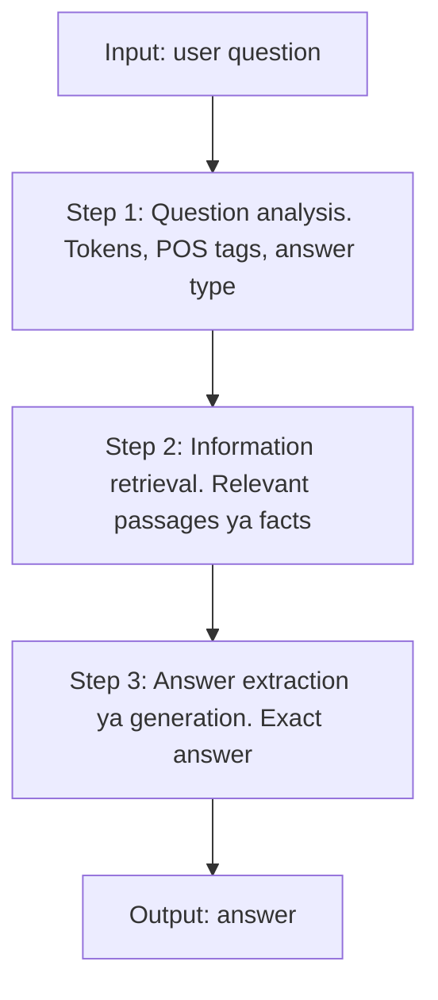

**In simple words:** question answering (QA) system question ka exact answer dhoondhta hai. Iska algorithm question analyse karne se answer extract karne tak steps ki fixed pipeline hai. <Cite id="class-nlp-m6" loc="slides 15-16" />

**Definition:** QA system ek AI program hai jo human-language questions ka precise facts ya short passages se automatically answer deta hai, whole documents ki lambi list nahi. 

**Algorithm (pipeline)**

1. **Question analysis / processing:** question ko tokenize karta hai, stop words hatata hai, part-of-speech (POS) tagging karta hai aur expected answer type pehchaanta hai (person, location, date ya definition, who, what, when jaise words se).
2. **Information retrieval (IR):** document store, knowledge graph ya vector database mein relevant passages ya facts search karta hai.
3. **Answer extraction / generation:** deep learning ya Transformer models (BERT ya generative LLMs) se retrieved context mein se exact answer pinpoint ya synthesize karta hai.

**Worked idea.** Question: "Who wrote Hamlet?" Step 1 answer type *person* nikaalta hai (*who* se). Step 2 Hamlet ke passages laata hai. Step 3 span "Shakespeare" chunta hai (extractive) ya sentence likhta hai (generative). (Ye example samajhne ke liye joda hai; slides mein nahi.)

**Types:** extractive, generative, open-domain aur closed-domain. <Cite id="class-nlp-m6" loc="slide 16" />

**Conclusion:** algorithm hai question analysis, phir retrieval, phir answer extraction ya generation.
