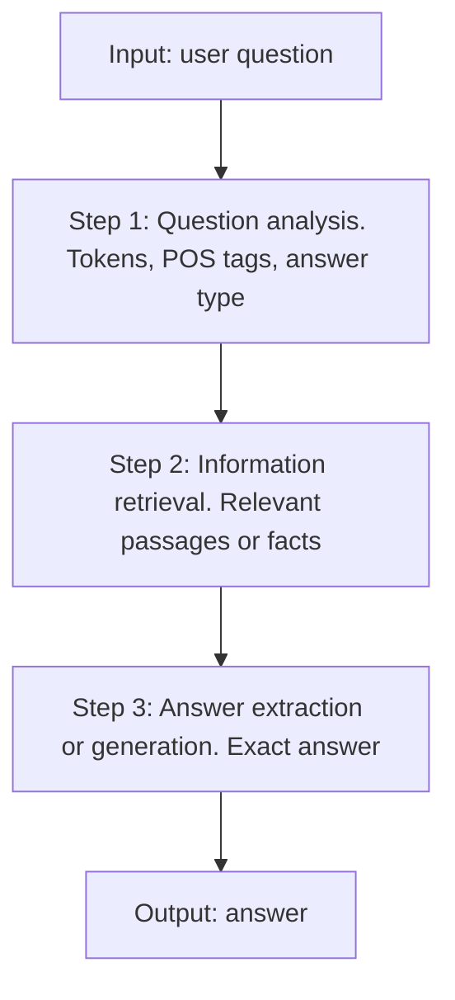

**In simple words:** a question answering (QA) system finds the exact answer to a question. Its algorithm is a fixed pipeline of steps, from analysing the question to extracting the answer. <Cite id="class-nlp-m6" loc="slides 15-16" />

**Definition:** a QA system is an AI program that automatically answers human-language questions with precise facts or short passages instead of a long list of whole documents.

**Algorithm (the pipeline)**

1. **Question analysis / processing:** tokenizes the question, removes stop words, does part-of-speech (POS) tagging and identifies the expected answer type (person, location, date or definition, from words like who, what, when).
2. **Information retrieval (IR):** searches a document store, knowledge graph or vector database for relevant passages or facts.
3. **Answer extraction / generation:** uses deep learning or Transformer models (like BERT or generative LLMs) to pinpoint or synthesize the exact answer from the retrieved context.

**Worked idea.** Question: "Who wrote Hamlet?" Step 1 finds the answer type *person* (from *who*). Step 2 retrieves passages about Hamlet. Step 3 picks the span "Shakespeare" (extractive) or writes a sentence (generative). (This example is added for clarity; it is not on the slides.)

**Types:** extractive, generative, open-domain and closed-domain. <Cite id="class-nlp-m6" loc="slide 16" />

**Conclusion:** the algorithm is question analysis, then retrieval, then answer extraction or generation.
