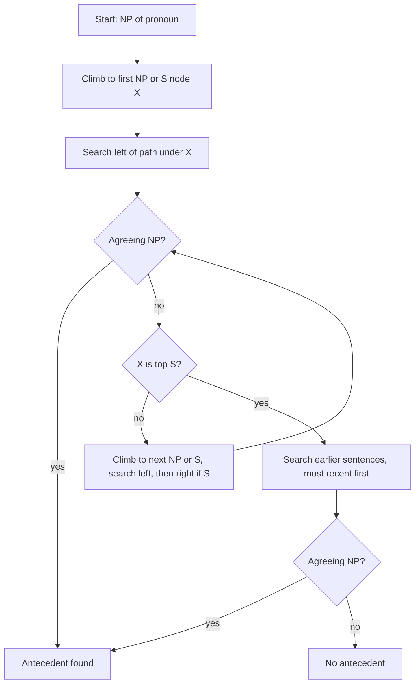

**In simple words:** Hobbs' algorithm (1978) *he* ya *it* jaise pronoun ka referent dhoondhta hai, current aur pehle ke sentences ke **parse trees** par ek fixed order mein chalkar, aur pehla wo noun phrase (NP) accept karta hai jo pronoun se agree karta ho. <Cite id="anaphora-resolution-hobbs1978" />

**Ye kyun zaroori hai:** pehli baar mention ke baad log *he*, *it*, *they* bolte hain. Translation, summarisation aur question answering ko pata hona chahiye ye kaun hain. Hobbs ek simple method deta hai jisme training data nahi chahiye. <Cite id="anaphora-resolution-tetreault2001" />

**Idea:** pronoun se bahar ki taraf search karo, sabse paas ki jagah pehle. Recent sentences purane se pehle, aur left (subject) side right se pehle.

**Steps** (X ek node hai, p us tak ka path):

1. Pronoun ke NP node se shuru karo.
2. Upar jaake pehle NP ya S node tak pahucho. Use X kaho.
3. X ke neeche, p ke left mein, left to right, breadth-first search karo. Koi bhi NP propose karo jiske aur X ke beech mein koi aur NP ya S ho.
4. Agar X sentence ka top S hai, to pehle ke sentences mein search karo, most recent pehle, left to right, breadth-first, aur har NP propose karo. Nahi to step 5.
5. Agle NP ya S node tak upar jao (naya X).
6. Agar X NP hai aur p uske neeche ke N-bar se nahi guzra, to X propose karo.
7. X ke neeche, p ke left mein, left to right, breadth-first search karke koi bhi NP propose karo.
8. Agar X S hai, to p ke right mein left to right search karo, lekin kisi NP ya S ke neeche mat jao. Koi bhi NP propose karo.
9. Step 4 par jao.

Proposed NP tabhi accept hota hai jab wo pronoun se number, gender aur person mein **agree** kare. <Cite id="discourse-reference-slp3-coref" />

**Example:** *Jack is an engineer. Jill likes him.* *him* ke NP se X sentence 2 ka S hai. Uske left mein *Jill* hai, lekin *Jill* aur X ke beech kuch nahi, isliye use skip karte hain (plain pronoun apne clause ke noun ko point nahi kar sakta). X top S hai, to search sentence 1 mein jaata hai aur sabse pehle *Jack* milta hai, jo agree karta hai (male, singular). Isliye *him* = *Jack*.

**Advantages:** simple, fast, training nahi, grammar ka achha use. 300 pronouns par lagbhag 88% sahi report hua. <Cite id="anaphora-resolution-hobbs1978" />

**Limitations:** sahi full parse chahiye, sirf pronouns handle karta hai, meaning ya world knowledge use nahi karta (Winograd cases fail), aur bina referent wala *it* handle nahi hota.

**Conclusion:** Hobbs' algorithm pronoun ko left-to-right, nearest-first tree search aur agreement check se resolve karta hai. <Cite id="anaphora-resolution-tp-nlp" />

Exam mein English mein likho: "Hobbs' algorithm traverses the parse trees in a fixed order and proposes the first NP that agrees with the pronoun."
