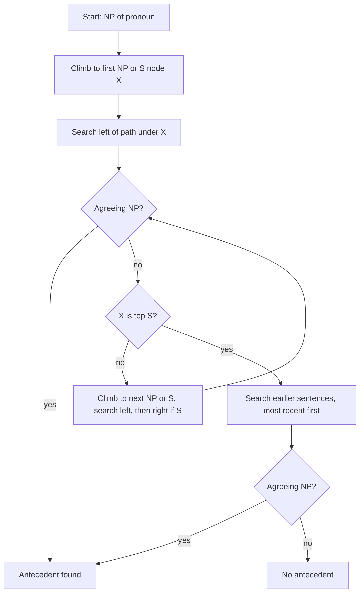

**In simple words:** Hobbs' algorithm (1978) finds what a pronoun like *he* or *it* refers to by walking over the **parse trees** of the current and earlier sentences in a fixed order and accepting the first noun phrase (NP) that agrees with the pronoun. <Cite id="anaphora-resolution-hobbs1978" />

**Why it is needed:** after the first mention, people say *he*, *it*, *they*. Translation, summarisation and question answering must know who these are. Hobbs gives a simple method that needs no training data. <Cite id="anaphora-resolution-tetreault2001" />

**Idea:** search outward from the pronoun, nearest places first. Recent sentences come before old ones, and the left (subject) side comes before the right.

**Steps** (X is a node, p the path to it):

1. Start at the NP node of the pronoun.
2. Go up to the first NP or S node. Call it X.
3. Search below X, to the left of p, left to right, breadth-first. Propose any NP that has another NP or S between it and X.
4. If X is the top S of the sentence, search earlier sentences, most recent first, left to right, breadth-first, and propose every NP met. Otherwise go to step 5.
5. Go up to the next NP or S node (the new X).
6. If X is an NP and p did not pass through the N-bar below it, propose X.
7. Search below X, left of p, left to right, breadth-first, and propose any NP.
8. If X is an S, search to the right of p, left to right, but do not go below any NP or S. Propose any NP.
9. Go to step 4.

A proposed NP is accepted only if it **agrees** in number, gender and person with the pronoun. <Cite id="discourse-reference-slp3-coref" />

**Example:** *Jack is an engineer. Jill likes him.* From the NP of *him*, X is the S of sentence 2. To its left is *Jill*, but nothing lies between *Jill* and X, so she is skipped (a plain pronoun cannot point to a noun in its own clause). X is the top S, so the search moves to sentence 1 and meets *Jack* first, who agrees (male, singular). So *him* = *Jack*.

**Advantages:** simple, fast, no training, uses grammar well. It reported about 88% correct on 300 pronouns. <Cite id="anaphora-resolution-hobbs1978" />

**Limitations:** needs a correct full parse, handles only pronouns, uses no meaning or world knowledge (Winograd cases fail), and *it* with no referent is not handled.

**Conclusion:** Hobbs' algorithm resolves pronouns by a left-to-right, nearest-first tree search plus an agreement check. <Cite id="anaphora-resolution-tp-nlp" />
