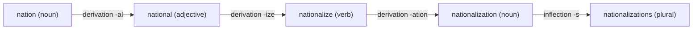

**In simple words:** morphology padhta hai ki words chhote parts se kaise bante hain, jinhe **morphemes** kehte hain. Stem se word banane ke do tareeke hain: **inflection** (usi word ka grammar form) aur **derivation** (naya word). <Cite id="morphology-fst-gfg-morph" /> <Cite id="morphology-fst-wiki-morpheme" />

**Inflectional morphology** mein aisa affix lagta hai jo sirf grammar mark karta hai: number, tense, person, comparison. Word class aur basic meaning wahi rehta hai. English mein sirf aath aise affixes hain: plural `-s`, possessive `-'s`, third-person `-s`, past `-ed`, past participle `-ed/-en`, `-ing`, comparative `-er` aur superlative `-est`. Examples: `cat` se `cats`, `walk` se `walked`, `big` se `bigger`. <Cite id="morphology-fst-wiki-inflection" />

**Derivational morphology** mein aisa affix lagta hai jo **naya word** banata hai, aksar nayi class ya meaning ke saath: `happy` (adjective) se `happiness` (noun), `teach` (verb) se `teacher` (noun), `kind` se `unkind`. <Cite id="morphology-fst-wiki-derivation" />

| Point | Inflectional | Derivational |
|---|---|---|
| Purpose | Usi word ka grammar form | Naya word banata hai |
| Word class | Nahi badalti | Aksar badalti hai |
| Meaning | Core meaning same | Naya ya badla hua meaning |
| Kitne words par lagta hai | Class ke lagbhag sabhi | Sirf kuch words par (`-ness` har adjective par nahi) |
| Position | Bahar, sabse last | Andar, stem ke paas |
| Dictionary | Same entry (lemma) | Alag entry |
| Example | `play` se `plays` | `play` se `player` |

**Ek word se illustration:** `unhappiness` = `un-` (derivation, negative) + `happy` (stem, spelling `happi` ho jaati hai) + `-ness` (derivation, adjective se noun). `-es` jodne par `unhappinesses` banta hai (inflection, plural). Sirf last step inflection hai.

**NLP mein use:** stemmer ya lemmatizer inflection aasaani se hatata hai aur derivation kam safely, taaki `plays` aur `played` dono `play` ban jaayein, jabki `player` alag reh sakta hai.

**Conclusion:** inflection grammar ke liye word ka form badalta hai; derivation naya word banata hai. Derivation andar, inflection bahar hota hai.

Exam mein English mein likho: "Inflection changes the grammatical form of a word without changing its class; derivation forms a new word, often of a different class."
