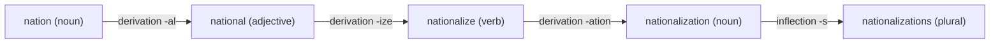

**In simple words:** morphology studies how words are built from smaller parts called **morphemes**. There are two ways to build a word from a stem: **inflection** (a grammar form of the same word) and **derivation** (a new word). <Cite id="morphology-fst-gfg-morph" /> <Cite id="morphology-fst-wiki-morpheme" />

**Inflectional morphology** adds an affix that only marks grammar: number, tense, person, comparison. The word class and the basic meaning stay the same. English has just eight such affixes: plural `-s`, possessive `-'s`, third-person `-s`, past `-ed`, past participle `-ed/-en`, `-ing`, comparative `-er` and superlative `-est`. Examples: `cat` to `cats`, `walk` to `walked`, `big` to `bigger`. <Cite id="morphology-fst-wiki-inflection" />

**Derivational morphology** adds an affix that makes a **new word**, often with a new class or meaning: `happy` (adjective) to `happiness` (noun), `teach` (verb) to `teacher` (noun), `kind` to `unkind`. <Cite id="morphology-fst-wiki-derivation" />

| Point | Inflectional | Derivational |
|---|---|---|
| Purpose | Grammar form of same word | Builds a new word |
| Word class | Does not change | Often changes |
| Meaning | Same core meaning | New or changed meaning |
| How many words it applies to | Almost all of a class | Only some words (`-ness` not on every adjective) |
| Position | Outer, last | Inner, nearer the stem |
| Dictionary | Same entry (lemma) | Separate entry |
| Example | `play` to `plays` | `play` to `player` |

**Illustration with one word:** `unhappiness` = `un-` (derivation, negative) + `happy` (stem, spelling changes to `happi`) + `-ness` (derivation, adjective to noun). Adding `-es` gives `unhappinesses` (inflection, plural). Only the last step is inflection.

**Use in NLP:** a stemmer or lemmatizer removes inflection easily and derivation less safely, so that `plays` and `played` map to `play`, while `player` may stay separate.

**Conclusion:** inflection changes the form of a word for grammar; derivation creates a new word. Derivation sits inside, inflection outside.
