**In simple words:** **stemmer** word ka ending kaat deta hai, taaki `connected`, `connecting` aur `connection` sab `connect` ban jaayein. Porter stemmer (Martin Porter, 1980) ye kaam suffix-stripping rules ki fixed list se paanch steps mein karta hai. Result ek stem hota hai, jo asli word hona zaroori nahi. <Cite id="porter-stemmer-def" /> <Cite id="porter-stemmer-gfg-stemming" />

**Ye kyun zaroori hai:** search engines aur classifiers `play`, `plays` aur `playing` ko ek hi idea maante hain. Stemming vocabulary chhoti karti hai aur recall badhati hai.

```mermaid
%% caption: Porter ke paanch steps order mein chalte hain. Har step sabse lamba matching suffix rule lagata hai jiski condition poori ho.
flowchart LR
  A["Word"] --> B["1a: plurals (sses to ss, ies to i, s to nothing)"]
  B --> C["1b: ed and ing, then clean-up"]
  C --> D["1c: y to i"]
  D --> E["2: long suffixes to short (ational to ate)"]
  E --> F["3: ical, ful, ness, ative"]
  F --> G["4: delete suffixes if m>1"]
  G --> H["5: final e and double l"]
  H --> I["Stem"]
```

**Key idea: measure m.** Word ko `[C](VC)^m[V]` likho, jahan C consonants ka run hai aur V vowels ka (`y` consonant ke baad vowel maana jaata hai). `m` vowel-consonant groups ginta hai. `tree` ka m=0, `trouble` ka m=1, `troubles` ka m=2. Ek rule tabhi chalta hai jab bacha hua stem condition poori kare, jaise `m>1` (stem kaafi lamba hai), `*v*` (stem mein vowel hai) ya `*d` (double consonant par khatam). Isse `bed` kat kar `b` nahi banta. <Cite id="porter-stemmer-def" />

**Steps:**

| Step | Kaam | Example |
|---|---|---|
| 1a | Plurals | `caresses` se `caress`, `ponies` se `poni` |
| 1b | `-eed`, `-ed`, `-ing` (stem mein vowel chahiye), phir fix-up (`at` se `ate`, double letter se single) | `hopping` se `hop`, `agreed` se `agree` |
| 1c | Stem mein vowel ho to `y` se `i` | `happy` se `happi` |
| 2 | Double suffixes map karo (m>0) | `relational` se `relate`, `generalization` se `generalize` |
| 3 | `-ful`, `-ness`, `-ical`, `-ative` jaise hatao (m>0) | `hopeful` se `hope` |
| 4 | `-al`, `-ance`, `-ate`, `-ment`, `-ous`, `-ize` jaise delete karo (m>1) | `adjustment` se `adjust` |
| 5 | Last `e` hatao (m>1), `ll` ko ghatao (m>1) | `probate` se `probat` |

<Sum>

<Given>

words `relational` aur `generalizations`.

</Given>

<Find>

dono ka Porter stem.

</Find>

<Steps>

1. **relational.** Step 1a se 1c kuch nahi karte (`s`, `ed`, `ing`, `y` nahi hai). Step 2: `ational` se `ate`, stem `rel` ka m=1 (>0), to `relate`. *Reason: step 2 lambe suffix ko chhote mein map karta hai.* Step 4: `ate` ke liye m>1 chahiye par `rel` ka m=1 hai, to wo rehta hai. Step 5: m>1 ho to last `e` hatao; `relat` ka m=2 hai, to `relat`.
2. **generalizations.** Step 1a: `s` hatao, to `generalization`. Step 2: `ization` se `ize` (stem `general`, m=3), to `generalize`. Step 3: `alize` se `al` (stem `gener`, m=2), to `general`. Step 4: `gener` ka m=2>1 hai, to `al` delete, to `gener`. Step 5: `e` nahi hai. *Reason: har step sabse lamba matching suffix chhota karta hai.*

</Steps>

<Answer>

`relational` se `relat`; `generalizations` se `gener`.

</Answer>

<Box kind="verify">

m check: `rel` = C V C, m=1; `relat` = C V C V C, m=2; `gener` = C V C V C, m=2. Path generalizations, generalization, generalize, general, gener wahi hai jo Porter ke paper mein diya hai.

</Box>

</Sum>

**Advantages:** fast, simple, dictionary nahi chahiye. **Limitations:** over-stemming (`university` aur `universe` dono `univers` dete hain), under-stemming (`data`, `datum`), aise stems jo word nahi hain (`poni`), sirf English. Snowball (Porter2) ise improve karta hai. <Cite id="porter-stemmer-snowball" />

**Conclusion:** Porter ka stemmer paanch rule-based steps mein suffix hatata hai, jo measure m se control hote hain.

Exam mein English mein likho: "The Porter stemmer removes suffixes in five ordered steps, each rule being applied only if a condition on the measure m of the stem holds."
