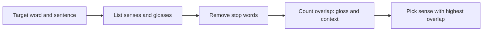

**In simple words:** kai words ke ek se zyada meaning (**sense**) hote hain. `bank` paise wali institution bhi ho sakta hai aur nadi ka kinara bhi. **Word Sense Disambiguation (WSD)** ka matlab hai context dekhkar word ka sahi sense chunna. <Cite id="word-sense-disambiguation-gfg-wsd" /> <Cite id="word-sense-disambiguation-slp3-I" />

**Ye kyun zaroori hai:** galat sense se galat translation (`bank` ka Hindi), galat search results aur galat answers milte hain.

**Methods ki teen families:** (1) dictionary ya knowledge-based (WordNet jaisi sense list use karta hai), (2) supervised (sense-tagged text se seekhta hai), (3) unsupervised (contexts ko cluster karta hai).

**Dictionary-based approach.** Ye har sense ki dictionary definition (**gloss**) use karta hai. Sabse famous method **Lesk algorithm** (Lesk, 1986) hai: sahi sense wo hai jiski gloss context ke saath sabse zyada words share kare. <Cite id="word-sense-disambiguation-wiki-lesk" />

1. Target word lo aur uske saare senses gloss ke saath likho.
2. Target ke aaspaas ke context words ikatthe karo. Stop words hatao.
3. Har sense ke liye gloss aur context ke common words gin lo (**overlap**).
4. Sabse zyada overlap wala sense chuno.

<Sum>

<Given>

sentence: *She went to the bank to deposit money and ask for a loan.* Simplified glosses (hamari apni, chhoti): sense 1 = "an institution where you deposit money and take a loan"; sense 2 = "sloping land beside a river".

</Given>

<Find>

`bank` ka sense.

</Find>

<Steps>

1. Context content words (stop words aur `bank` hata ke): went, deposit, money, ask, loan.
2. Sense 1 content words: institution, deposit, money, take, loan. Context ke saath overlap = deposit, money, loan = 3.
3. Sense 2 content words: sloping, land, beside, river. Overlap = 0.
4. Sabse zyada overlap sense 1 ka hai.

</Steps>

<Answer>

`bank` = paise wali institution (3 vs 0).

</Answer>

<Box kind="verify">

Common sense check: *deposit*, *money* aur *loan* sab finance ke hain, aur *river* ka sentence se koi link nahi. Ulta count (gloss ke words jo sentence mein hain) bhi 3 aur 0 deta hai.

</Box>

</Sum>

**Extended Lesk** related senses (hypernyms, hyponyms) ki glosses bhi ginta hai, taaki zyada overlaps mile. NLTK mein `nltk.wsd.lesk` hai. <Cite id="word-sense-disambiguation-nltk-wsd" />

**Advantages:** training data nahi chahiye, aasaan. **Limitations:** chhoti glosses se kam overlaps milte hain, exact word match synonyms miss karta hai, aur result dictionary par depend karta hai.

**Conclusion:** WSD context se word ka sense chunta hai; dictionary approach (Lesk) wo sense chunta hai jiski definition context se sabse zyada overlap kare.

Exam mein English mein likho: "In the Lesk algorithm, the sense whose dictionary gloss has the largest overlap with the context words is selected."
