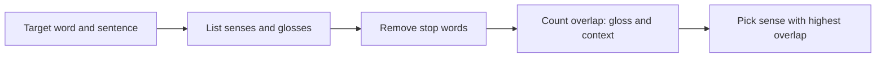

**In simple words:** many words have more than one meaning (**sense**). `bank` can be a money institution or the side of a river. **Word Sense Disambiguation (WSD)** is choosing the right sense of a word from its context. <Cite id="word-sense-disambiguation-gfg-wsd" /> <Cite id="word-sense-disambiguation-slp3-I" />

**Why it is needed:** a wrong sense gives wrong translation (`bank` in Hindi), wrong search results and wrong answers.

**Three families of methods:** (1) dictionary or knowledge-based (uses a sense inventory such as WordNet), (2) supervised (learns from sense-tagged text), (3) unsupervised (clusters contexts).

**Dictionary-based approach.** It uses the dictionary definitions (**glosses**) of each sense. The best known method is the **Lesk algorithm** (Lesk, 1986): the right sense is the one whose gloss shares the most words with the context. <Cite id="word-sense-disambiguation-wiki-lesk" />

1. Take the target word and list all its senses with their glosses.
2. Collect the context words around the target. Remove stop words.
3. For each sense, count the words shared by its gloss and the context (the **overlap**).
4. Choose the sense with the highest overlap.

<Sum>

<Given>

sentence: *She went to the bank to deposit money and ask for a loan.* Simplified glosses (our own, short): sense 1 = "an institution where you deposit money and take a loan"; sense 2 = "sloping land beside a river".

</Given>

<Find>

the sense of `bank`.

</Find>

<Steps>

1. Context content words (stop words and `bank` removed): went, deposit, money, ask, loan.
2. Sense 1 content words: institution, deposit, money, take, loan. Overlap with context = deposit, money, loan = 3.
3. Sense 2 content words: sloping, land, beside, river. Overlap = 0.
4. Highest overlap is sense 1.

</Steps>

<Answer>

`bank` = the money institution (3 against 0).

</Answer>

<Box kind="verify">

Common sense check: *deposit*, *money* and *loan* all belong to finance, and *river* has no link to the sentence. Counting the other way (gloss words found in the sentence) also gives 3 and 0.

</Box>

</Sum>

**Extended Lesk** also counts the glosses of related senses (hypernyms, hyponyms) so more overlaps appear. NLTK has `nltk.wsd.lesk`. <Cite id="word-sense-disambiguation-nltk-wsd" />

**Advantages:** no training data needed, easy. **Limitations:** short glosses give few overlaps, exact word match misses synonyms, and the result depends on the dictionary.

**Conclusion:** WSD picks a word's sense from context; the dictionary approach (Lesk) chooses the sense whose definition overlaps most with the context.
