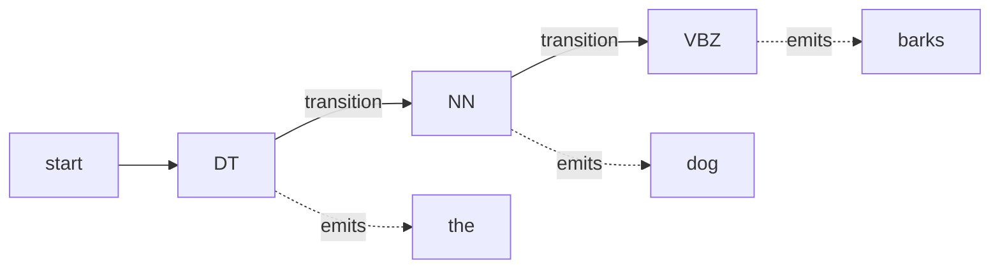

**In simple words:** Hidden Markov Model (HMM) tagger tags ko ek hidden chain maanta hai aur words ko wo jo hum dekhte hain. Ye us tag sequence ko dhoondhta hai jo sentence ke liye sabse probable ho. <Cite id="hmm-maxent-crf-slp3-appA" /> <Cite id="pos-tagging-gfg-hmm" />

**Ye kyun zaroori hai:** kai words ke kai tags hote hain (`book` noun ya verb). Aas-paas ke tags aur word ke usual tag ko saath dekhne se ye solve ho jaata hai.

**Model ke parts:**

- **States** = POS tags (hidden), **observations** = words (visible).
- **Transition probability** $P(t_i \mid t_{i-1})$: pichhle tag ke baad ye tag kitna likely hai (determiner ke baad aksar noun aata hai).
- **Emission probability** $P(w_i \mid t_i)$: ye tag is word ko kitna produce karta hai.
- Dono tagged corpus mein ginti se nikalte hain: $P(t_i\mid t_{i-1}) = C(t_{i-1},t_i)/C(t_{i-1})$ aur $P(w_i\mid t_i) = C(t_i,w_i)/C(t_i)$.

**Tagging rule.** Bayes' rule aur do assumptions ke saath (word sirf apne tag par depend karta hai; tag sirf pichhle tag par), best tags ye hain

$$
\hat{t}_{1..n} = \arg\max_{t_{1..n}} \prod_{i=1}^{n} P(w_i \mid t_i)\,P(t_i \mid t_{i-1})
$$

Har tag sequence try karna bahut slow hai, isliye **Viterbi algorithm** (dynamic programming) har word par har tag ka best score rakhta hai aur best path wapas trace karta hai. <Cite id="pos-tagging-wiki-viterbi" />

<Sum>

<Given>

`to` ke baad word `book`. Assumed values: $P(VB\mid TO)=0.8$, $P(NN\mid TO)=0.1$, $P(book\mid VB)=0.002$, $P(book\mid NN)=0.001$.

</Given>

<Find>

`book` ke liye better tag.

</Find>

<Steps>

1. VB ka score $= 0.8 \times 0.002 = 0.0016$. *Reason: transition guna emission.*
2. NN ka score $= 0.1 \times 0.001 = 0.0001$.
3. Compare: $0.0016 > 0.0001$, to VB.

</Steps>

<Answer>

`book` ko VB (verb) tag milta hai, NN se 16 guna zyada likely.

</Answer>

<Box kind="verify">

Ratio: $0.0016 / 0.0001 = 16$. Dusre tareeke se: $(0.8/0.1)\times(0.002/0.001) = 8 \times 2 = 16$.

</Box>

</Sum>

**Advantages:** simple, fast, kaafi data ho to lagbhag 95 percent accuracy, Viterbi ke saath chalta hai. **Limitations:** tagged corpus chahiye, unknown words ka emission estimate kharab hota hai, sirf pichhla tag dekhta hai, aur suffix jaise rich features use nahi kar sakta (MaxEnt aur CRF kar sakte hain).

**Conclusion:** HMM tagger wo tag sequence chunta hai jiska transition aur emission probabilities ka product sabse bada ho, jo Viterbi se efficiently milta hai.

Exam mein English mein likho: "An HMM tagger chooses the tag sequence that maximises the product of transition and emission probabilities, using the Viterbi algorithm."
