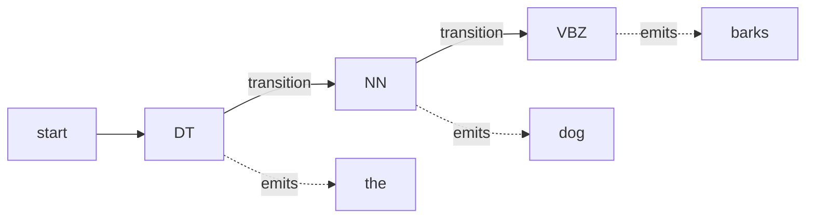

**In simple words:** a Hidden Markov Model (HMM) tagger treats the tags as a hidden chain and the words as what we see. It finds the tag sequence that is most probable for the sentence. <Cite id="hmm-maxent-crf-slp3-appA" /> <Cite id="pos-tagging-gfg-hmm" />

**Why it is needed:** many words have several tags (`book` is a noun or a verb). Looking at the neighbouring tags and the word's usual tag together resolves this.

**Parts of the model:**

- **States** = POS tags (hidden), **observations** = words (visible).
- **Transition probability** $P(t_i \mid t_{i-1})$: how likely a tag follows the previous tag (a determiner is often followed by a noun).
- **Emission probability** $P(w_i \mid t_i)$: how likely a tag is to produce this word.
- Both are estimated by counting in a tagged corpus: $P(t_i\mid t_{i-1}) = C(t_{i-1},t_i)/C(t_{i-1})$ and $P(w_i\mid t_i) = C(t_i,w_i)/C(t_i)$.

**Tagging rule.** By Bayes' rule, with two assumptions (a word depends only on its own tag; a tag depends only on the previous tag), the best tags are

$$
\hat{t}_{1..n} = \arg\max_{t_{1..n}} \prod_{i=1}^{n} P(w_i \mid t_i)\,P(t_i \mid t_{i-1})
$$

Trying every tag sequence is too slow, so the **Viterbi algorithm** (dynamic programming) keeps the best score for each tag at each word and traces back the best path. <Cite id="pos-tagging-wiki-viterbi" />

<Sum>

<Given>

after `to`, the word `book`. Assumed values: $P(VB\mid TO)=0.8$, $P(NN\mid TO)=0.1$, $P(book\mid VB)=0.002$, $P(book\mid NN)=0.001$.

</Given>

<Find>

the better tag for `book`.

</Find>

<Steps>

1. Score for VB $= 0.8 \times 0.002 = 0.0016$. *Reason: transition times emission.*
2. Score for NN $= 0.1 \times 0.001 = 0.0001$.
3. Compare: $0.0016 > 0.0001$, so VB.

</Steps>

<Answer>

`book` is tagged VB (verb), 16 times more likely than NN.

</Answer>

<Box kind="verify">

Ratio: $0.0016 / 0.0001 = 16$. Recomputed the other way: $(0.8/0.1)\times(0.002/0.001) = 8 \times 2 = 16$.

</Box>

</Sum>

**Advantages:** simple, fast, about 95 percent accuracy with enough data, works with Viterbi. **Limitations:** needs a tagged corpus, unknown words get poor emission estimates, sees only the previous tag, and cannot use rich features such as suffixes (MaxEnt and CRF can).

**Conclusion:** an HMM tagger picks the tag sequence with the largest product of transition and emission probabilities, found efficiently by Viterbi.
