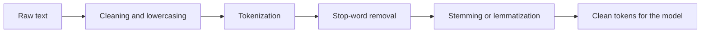

**In simple words:** raw text messy hota hai (capital letters, punctuation, HTML, ek word ke kai forms). **Preprocessing** use saaf karta hai aur simple units mein todta hai, taaki NLP model use kar sake. <Cite id="text-preprocessing-gfg-pre" /> <Cite id="text-preprocessing-av-pre" />

**Ye kyun zaroori hai:** nahi to `Play`, `play` aur `playing` teen alag words ginte jaayenge, aur noise words kaam ke words ko chhupa denge.

**Ek example ke saath steps.** Raw text: `The kids were playing happily in the garden!`

| Step | Kya karta hai | Result |
|---|---|---|
| 1. Cleaning and lowercasing | HTML, symbols, extra spaces, punctuation hatao; saare letters chhote karo taaki `The` aur `the` same ho | `the kids were playing happily in the garden` |
| 2. Tokenization | Words (tokens) mein todo. Paragraph ho to pehle sentence segmentation | `the, kids, were, playing, happily, in, the, garden` |
| 3. Stop-word removal | Bahut common words hatao jinka meaning kam hai (`the`, `were`, `in`) | `kids, playing, happily, garden` |
| 4a. Stemming | Rules se ending kaato (Porter) | `kid, play, happili, garden` |
| 4b. Lemmatization | Dictionary aur part of speech se asli base word do | `kid, play, happily, garden` |

<Cite id="text-preprocessing-slp3-ch2" />

**Dusre useful steps:** spelling correction (`recieve` se `receive`), contractions expand karna (`don't` se `do not`), numbers, emojis aur URLs handle karna, aur grammar zaroori ho to POS tagging.

**Stemming vs lemmatization:** stemming fast hai par non-words bana sakti hai (`happili`; original 1980 Porter rules `play` ko `plai` bhi bana dete hain, NLTK ka default `play` rakhta hai); lemmatization valid words deti hai par slow hai aur dictionary chahiye. <Cite id="text-preprocessing-ibm-stemlem" />

**Savdhani:** jahan stop words matter karte hain wahan unhe mat hatao (sentiment mein `not`, question answering); lowercasing se `Apple` company aur `apple` fruit ka fark kho sakta hai.

**Conclusion:** preprocessing noisy text ko chhote, saaf, consistent tokens mein badalta hai; kaun se steps lene hain wo task par depend karta hai.

Exam mein English mein likho: "Preprocessing consists of cleaning, tokenization, stop-word removal and stemming or lemmatization."
