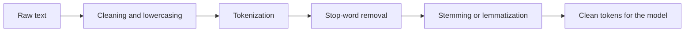

**In simple words:** raw text is messy (capital letters, punctuation, HTML, many word forms). **Preprocessing** cleans it and breaks it into simple units so that an NLP model can use it. <Cite id="text-preprocessing-gfg-pre" /> <Cite id="text-preprocessing-av-pre" />

**Why it is needed:** `Play`, `play` and `playing` would otherwise count as three different words, and noise words would hide the useful ones.

**Steps with one example.** Raw text: `The kids were playing happily in the garden!`

| Step | What it does | Result |
|---|---|---|
| 1. Cleaning and lowercasing | Remove HTML, symbols, extra spaces, punctuation; make all letters small so `The` equals `the` | `the kids were playing happily in the garden` |
| 2. Tokenization | Split into words (tokens). Sentence segmentation comes first for a paragraph | `the, kids, were, playing, happily, in, the, garden` |
| 3. Stop-word removal | Delete very common words that carry little meaning (`the`, `were`, `in`) | `kids, playing, happily, garden` |
| 4a. Stemming | Chop endings with rules (Porter) | `kid, play, happili, garden` |
| 4b. Lemmatization | Use a dictionary and the part of speech to give the real base word | `kid, play, happily, garden` |

<Cite id="text-preprocessing-slp3-ch2" />

**Other useful steps:** spelling correction (`recieve` to `receive`), expanding contractions (`don't` to `do not`), handling numbers, emojis and URLs, and POS tagging when the grammar matters.

**Stemming versus lemmatization:** stemming is fast but can produce non-words (`happili`; the original 1980 Porter rules even turn `play` into `plai`, while NLTK's default keeps `play`); lemmatization gives valid words but is slower and needs a dictionary. <Cite id="text-preprocessing-ibm-stemlem" />

**Cautions:** do not remove stop words for tasks where they matter (`not` in sentiment, question answering); lowercasing can lose the difference between `Apple` the company and `apple` the fruit.

**Conclusion:** preprocessing turns noisy text into a small set of clean, consistent tokens; the steps chosen depend on the task.
