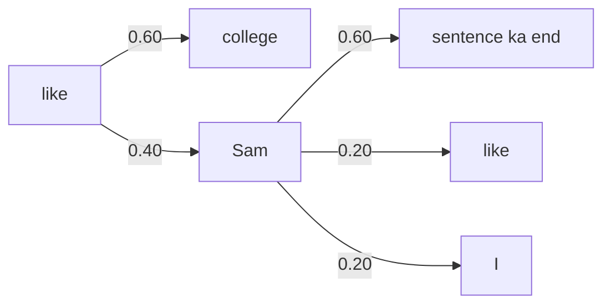

**In simple words:** bigram model gintaa hai ki ek word ke baad doosra word kitni baar aata hai. Agla word wahi hai jiski probability sabse high ho.

**Formula:** $P(B \mid A) = \text{count}(AB) / \text{count}(A)$, bigram count ko unigram count se divide karo. <Cite id="class-nlp-m2" loc="p. 9" />

<Sum>

<Given>

Corpus (7 sentences, har ek mein `<s>` aur `</s>`): `<s>` I am Sam `</s>`; `<s>` I like college `</s>`; `<s>` Do Sam like college `</s>`; `<s>` Sam I am `</s>`; `<s>` Do I like Sam `</s>`; `<s>` Do I like college `</s>`; `<s>` I do like Sam `</s>`. Class ki tarah "Do" aur "do" alag words hain. <Cite id="class-nlp-m2" loc="p. 10" />

</Given>

<Find>

saare bigrams, unki conditional probabilities, aur **like** aur **Sam** ke baad ka agla word.

</Find>

<Steps>

1. **Unigram counts:** `<s>` 7, I 6, am 2, Sam 5, like 5, college 3, Do 3, do 1, `</s>` 7. (39 tokens.) <Cite id="class-nlp-m2" loc="p. 10" />
2. **Saare 17 bigrams** $P(B \mid A) = \text{count}(AB)/\text{count}(A)$ ke saath (kul 32 bigrams: 39 tokens minus 7 sentences). <Cite id="class-nlp-m2" loc="p. 11" />

Table mein n(AB) = count(AB), n(A) = count(A) aur P = P(B given A).

| Bigram AB | n(AB) | n(A) | P |
|---|---|---|---|
| `<s>` I | 3 | 7 | 3/7 = 0.43 |
| I am | 2 | 6 | 1/3 = 0.33 |
| am Sam | 1 | 2 | 1/2 = 0.50 |
| Sam `</s>` | 3 | 5 | 3/5 = 0.60 |
| I like | 3 | 6 | 1/2 = 0.50 |
| like college | 3 | 5 | 3/5 = 0.60 |
| college `</s>` | 3 | 3 | 1 = 1.00 |
| `<s>` Do | 3 | 7 | 3/7 = 0.43 |
| Do Sam | 1 | 3 | 1/3 = 0.33 |
| Sam like | 1 | 5 | 1/5 = 0.20 |
| `<s>` Sam | 1 | 7 | 1/7 = 0.14 |
| Sam I | 1 | 5 | 1/5 = 0.20 |
| am `</s>` | 1 | 2 | 1/2 = 0.50 |
| Do I | 2 | 3 | 2/3 = 0.67 |
| like Sam | 2 | 5 | 2/5 = 0.40 |
| I do | 1 | 6 | 1/6 = 0.17 |
| do like | 1 | 1 | 1 = 1.00 |

3. **like ke baad:** college 3/5 = 0.60, Sam 2/5 = 0.40.
4. **Sam ke baad:** `</s>` 3/5 = 0.60, like 1/5 = 0.20, I 1/5 = 0.20.

</Steps>

<Answer>

**like** ke baad agla word = **college** (0.60). **Sam** ke baad agla word = **`</s>`**, yaani sentence ka end (0.60).

</Answer>

<Box kind="verify">

like ke baad: 3/5 + 2/5 = 1. Sam ke baad: 3/5 + 1/5 + 1/5 = 1. Bigram counts ka sum 32 = 39 - 7.

</Box>

</Sum>

**Class se check:** handwritten bigram counts aur typed final answers isse match karte hain (like ke baad college, Sam ke baad sentence ka end). Typed probabilities ki list mein kuch counts galat hain (jaise college ko 3 ki jagah 2 gina, aur Do I ko 2 ki jagah 1), isliye upar ki recomputed table use karo. <Cite id="class-nlp-pyq2" loc="p. 4" />

**Conclusion:** model like ke baad college aur Sam ke baad sentence ka end predict karta hai.
