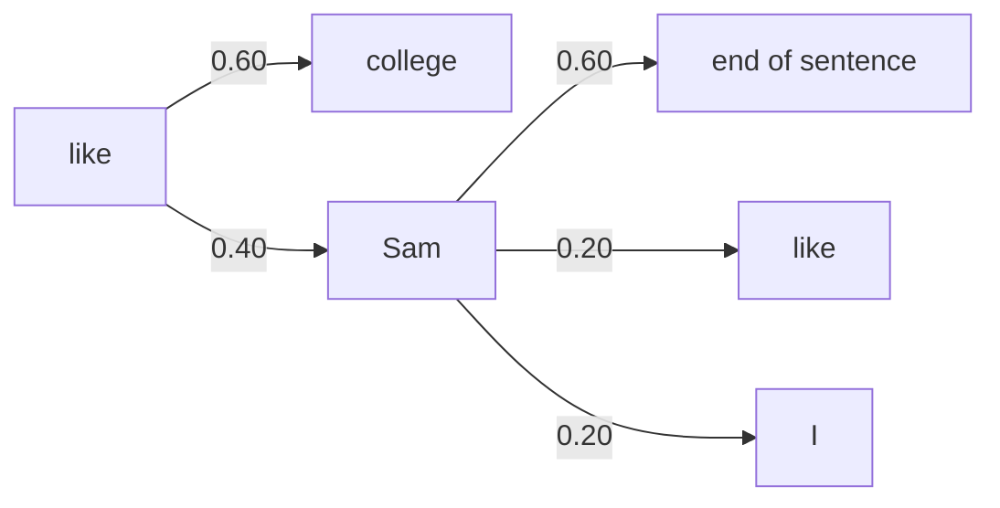

**In simple words:** a bigram model counts how often one word follows another. The next word is the one with the highest probability.

**Formula:** $P(B \mid A) = \text{count}(AB) / \text{count}(A)$, the bigram count over the unigram count. <Cite id="class-nlp-m2" loc="p. 9" />

<Sum>

<Given>

Corpus (7 sentences, each with `<s>` and `</s>`): `<s>` I am Sam `</s>`; `<s>` I like college `</s>`; `<s>` Do Sam like college `</s>`; `<s>` Sam I am `</s>`; `<s>` Do I like Sam `</s>`; `<s>` Do I like college `</s>`; `<s>` I do like Sam `</s>`. As in the class, "Do" and "do" are different words. <Cite id="class-nlp-m2" loc="p. 10" />

</Given>

<Find>

all bigrams, their conditional probabilities, and the next word after **like** and after **Sam**.

</Find>

<Steps>

1. **Unigram counts:** `<s>` 7, I 6, am 2, Sam 5, like 5, college 3, Do 3, do 1, `</s>` 7. (39 tokens.) <Cite id="class-nlp-m2" loc="p. 10" />
2. **All 17 bigrams** with $P(B \mid A) = \text{count}(AB)/\text{count}(A)$ (32 bigrams in all: 39 tokens minus 7 sentences). <Cite id="class-nlp-m2" loc="p. 11" />

In the table, n(AB) = count(AB), n(A) = count(A) and P = P(B given A).

| Bigram AB | n(AB) | n(A) | P |
|---|---|---|---|
| `<s>` I | 3 | 7 | 3/7 = 0.43 |
| I am | 2 | 6 | 1/3 = 0.33 |
| am Sam | 1 | 2 | 1/2 = 0.50 |
| Sam `</s>` | 3 | 5 | 3/5 = 0.60 |
| I like | 3 | 6 | 1/2 = 0.50 |
| like college | 3 | 5 | 3/5 = 0.60 |
| college `</s>` | 3 | 3 | 1 = 1.00 |
| `<s>` Do | 3 | 7 | 3/7 = 0.43 |
| Do Sam | 1 | 3 | 1/3 = 0.33 |
| Sam like | 1 | 5 | 1/5 = 0.20 |
| `<s>` Sam | 1 | 7 | 1/7 = 0.14 |
| Sam I | 1 | 5 | 1/5 = 0.20 |
| am `</s>` | 1 | 2 | 1/2 = 0.50 |
| Do I | 2 | 3 | 2/3 = 0.67 |
| like Sam | 2 | 5 | 2/5 = 0.40 |
| I do | 1 | 6 | 1/6 = 0.17 |
| do like | 1 | 1 | 1 = 1.00 |

3. **After like:** college 3/5 = 0.60, Sam 2/5 = 0.40.
4. **After Sam:** `</s>` 3/5 = 0.60, like 1/5 = 0.20, I 1/5 = 0.20.

</Steps>

<Answer>

Next word after **like** = **college** (0.60). Next word after **Sam** = **`</s>`**, the end of the sentence (0.60).

</Answer>

<Box kind="verify">

After like: 3/5 + 2/5 = 1. After Sam: 3/5 + 1/5 + 1/5 = 1. The bigram counts add up to 32 = 39 - 7.

</Box>

</Sum>

**Check against the class:** the handwritten bigram counts and the typed final answers agree with this (college after like, end of sentence after Sam). The typed list of probabilities has some wrong counts (for example college counted as 2 words instead of 3, and Do I as 1 instead of 2), so use the recomputed table above. <Cite id="class-nlp-pyq2" loc="p. 4" />

**Conclusion:** the model predicts college after like and the end of the sentence after Sam.
