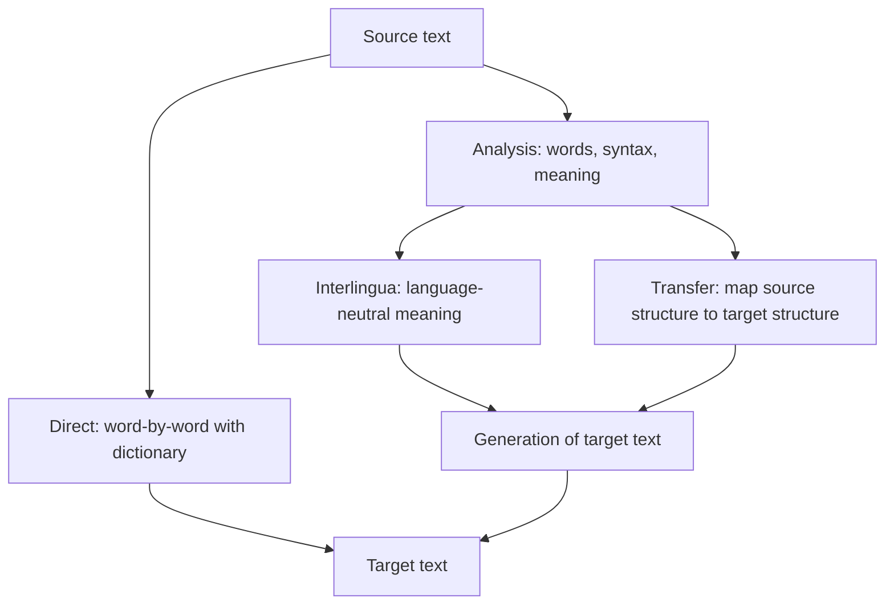

**In simple words:** **Machine Translation (MT)** ka matlab hai software se text ko source language se target language mein translate karna, jaise English se Hindi. <Cite id="ambiguity-challenges-wiki-mt" /> <Cite id="pyq-2025-05-gfg-mt" />

**Ye mushkil kyun hai:** languages ka word order alag hota hai (English *Ram eats an apple* Subject-Verb-Object hai; Hindi *Ram seb khata hai* Subject-Object-Verb hai), grammar alag hoti hai, aur words ke kai senses aur idioms hote hain. Word-by-word badalna fail ho jaata hai.

**Approaches:**

1. **Rule-based MT (RBMT).** Haath se likhe dictionaries aur grammar rules. Teen levels, shallow se deep:
   - *Direct:* bilingual dictionary mein har word dekho, phir reorder karo.
   - *Transfer:* source ko parse tree mein analyse karo, rules se target tree mein transfer karo, phir sentence generate karo.
   - *Interlingua:* source ko language-neutral meaning mein badlo, phir usse koi bhi target language generate karo.
2. **Corpus-based MT.** Bade parallel text (do languages mein wahi sentences) se seekhta hai:
   - *Example-based:* stored translated phrases dubara use karta hai.
   - *Statistical (SMT):* source $f$ ke liye wo target sentence $e$ chunta hai jo $P(f \mid e)\,P(e)$ maximise kare, yaani translation model (word aur phrase alignments) guna target language model.
3. **Neural MT (NMT).** Encoder source ko vectors mein padhta hai aur decoder target ko word by word likhta hai, relevant source words par **attention** ke saath. Transformer aaj ka standard model hai. <Cite id="nlp-introduction-transformer" />

| Approach | Kya chahiye | Strength | Weakness |
|---|---|---|---|
| Rule-based | Experts, dictionaries | Predictable, big data nahi | Rules mehenge, brittle |
| Statistical | Bada parallel corpus | Learned, fluent phrases | Door ke word orders mein kamzor |
| Neural | Bahut bada corpus, GPUs | Sabse fluent aur accurate | Bahut data chahiye, hallucinate kar sakta hai |

**Evaluation:** BLEU machine output ko human references se word groups match karke compare karta hai; human judges adequacy aur fluency dekhte hain.

**Applications:** Google Translate, subtitles, cross-language search, customer support.

**Conclusion:** MT rules se statistics aur phir neural networks tak aaya hai, aur neural systems ab best quality dete hain, par low-resource languages aur idioms abhi bhi mushkil hain.

Exam mein English mein likho: "MT approaches are rule-based (direct, transfer, interlingua), corpus-based (example-based, statistical) and neural."
