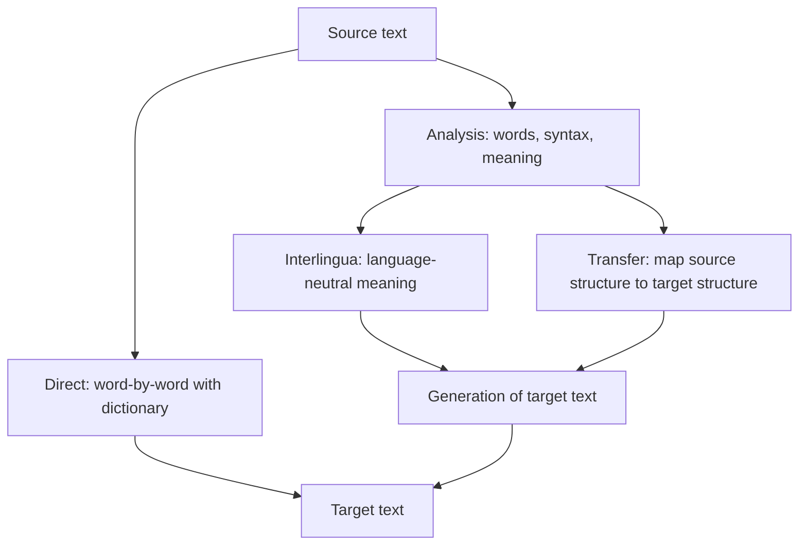

**In simple words:** **Machine Translation (MT)** is the use of software to translate text from a source language to a target language, for example English to Hindi. <Cite id="ambiguity-challenges-wiki-mt" /> <Cite id="pyq-2025-05-gfg-mt" />

**Why it is hard:** languages differ in word order (English *Ram eats an apple* is Subject-Verb-Object; Hindi *Ram seb khata hai* is Subject-Object-Verb), in grammar, and words have many senses and idioms. A word-by-word swap fails.

**Approaches:**

1. **Rule-based MT (RBMT).** Hand-written dictionaries and grammar rules. Three levels, from shallow to deep:
   - *Direct:* look up each word in a bilingual dictionary, then reorder.
   - *Transfer:* analyse the source into a parse tree, transfer it to a target tree using rules, then generate the sentence.
   - *Interlingua:* convert the source into a language-neutral meaning, then generate any target language from it.
2. **Corpus-based MT.** Learns from large parallel text (the same sentences in two languages):
   - *Example-based:* reuse stored translated phrases.
   - *Statistical (SMT):* choose the target sentence $e$ for source $f$ that maximises $P(f \mid e)\,P(e)$, a translation model (word and phrase alignments) times a target language model.
3. **Neural MT (NMT).** An encoder reads the source into vectors and a decoder writes the target word by word, with **attention** to the relevant source words. The Transformer is the standard model today. <Cite id="nlp-introduction-transformer" />

| Approach | Needs | Strength | Weakness |
|---|---|---|---|
| Rule-based | Experts, dictionaries | Predictable, no big data | Costly rules, brittle |
| Statistical | Large parallel corpus | Learned, fluent phrases | Poor for far-apart word orders |
| Neural | Very large corpus, GPUs | Most fluent and accurate | Needs lots of data, can hallucinate |

**Evaluation:** BLEU compares machine output with human references by matching word groups; human judges check adequacy and fluency.

**Applications:** Google Translate, subtitles, cross-language search, customer support.

**Conclusion:** MT has moved from rules to statistics to neural networks, and neural systems now give the best quality, though low-resource languages and idioms remain hard.
