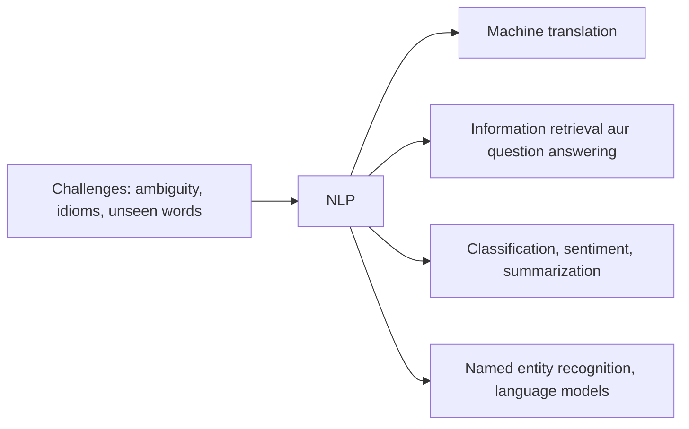

**In simple words:** NLP mushkil isliye hai ki language ambiguous hai, aur useful isliye hai ki language har jagah hai.

**Challenges** <Cite id="class-nlp-m1" loc="p. 3" />

- Har stage par **ambiguity**: lexical (bank), syntactic (I saw a man with telescope), semantic (someone ate every slice of pizza), anaphoric (Mary told Susan that she had won) aur pragmatic (Do you know the time?). <Cite id="class-nlp-m1" loc="p. 3" /> <Cite id="class-nlp-m1" loc="p. 6" /> <Cite id="class-nlp-m1" loc="p. 7" />
- **Figurative language** jaise idioms aur metaphors ("I'm falling for you"). <Cite id="class-nlp-asol" loc="p. 1" />
- **Unseen words aur domains:** out-of-vocabulary words aur wo models jo ek domain mein chalte hain par dusre mein nahi. <Cite id="class-nlp-pyq3" loc="p. 5" />

**Applications** (jaise class mein padhaya)

| Application | Kya karta hai | Example |
|---|---|---|
| Machine translation | Text ya speech ko ek language se dusri mein automatically translate karta hai <Cite id="class-nlp-m6" loc="slide 1" /> | Website localization, subtitles <Cite id="class-nlp-m6" loc="slide 7" /> |
| Information retrieval | Bade collection se relevant documents dhundta hai aur query ke liye rank karta hai <Cite id="class-nlp-m6" loc="slide 9" /> | Search engine |
| Question answering | Human-language questions ka precise facts ya short passages se jawab deta hai <Cite id="class-nlp-m6" loc="slide 15" /> | Who, what, when questions |
| Text classification | Text ko predefined labels assign karta hai <Cite id="class-nlp-m6" loc="slide 18" /> | Spam detection, topic labeling |
| Summarization | Bade text ko chhota karta hai aur essential information rakhta hai <Cite id="class-nlp-m6" loc="slide 23" /> | Banking, law, healthcare reports |
| Sentiment analysis | Opinions aur emotions dhundta hai: positive, negative ya neutral <Cite id="class-nlp-m6" loc="slide 26" /> | Customer feedback |
| Named entity recognition | Logon, jagahon, organizations, dates ke naam dhundta hai <Cite id="class-nlp-m6" loc="slide 35" /> | Amazon company, Amazon forest |
| Language models | Agla word predict karte hain aur sentences ko score dete hain <Cite id="class-nlp-m6" loc="slide 40" /> | Text prediction, spelling correction <Cite id="class-nlp-pyq2" loc="p. 8" /> |
| Speech assistants | Bole hue requests samajhte aur jawab dete hain <Cite id="class-nlp-m1" loc="p. 1" /> | Alexa, Siri, ChatGPT |

**Conclusion:** ambiguity main challenge hai, aur upar ke applications wo wajah hain ki ise solve karna zaroori hai.
