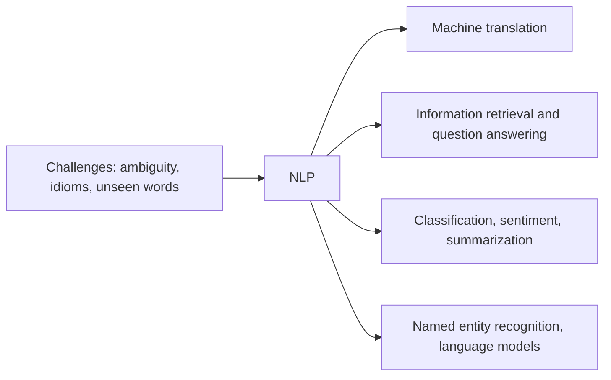

**In simple words:** NLP is hard because language is ambiguous, and it is useful because language is everywhere.

**Challenges** <Cite id="class-nlp-m1" loc="p. 3" />

- **Ambiguity** at every stage: lexical (bank), syntactic (I saw a man with telescope), semantic (someone ate every slice of pizza), anaphoric (Mary told Susan that she had won) and pragmatic (Do you know the time?). <Cite id="class-nlp-m1" loc="p. 3" /> <Cite id="class-nlp-m1" loc="p. 6" /> <Cite id="class-nlp-m1" loc="p. 7" />
- **Figurative language** such as idioms and metaphors ("I'm falling for you"). <Cite id="class-nlp-asol" loc="p. 1" />
- **Unseen words and domains:** out-of-vocabulary words and models that work in one domain but not in another. <Cite id="class-nlp-pyq3" loc="p. 5" />

**Applications** (as taught in the class)

| Application | What it does | Example |
|---|---|---|
| Machine translation | Automatically translates text or speech from one language to another <Cite id="class-nlp-m6" loc="slide 1" /> | Website localization, subtitles <Cite id="class-nlp-m6" loc="slide 7" /> |
| Information retrieval | Finds relevant documents from a large collection and ranks them for a query <Cite id="class-nlp-m6" loc="slide 9" /> | A search engine |
| Question answering | Answers human-language questions with precise facts or short passages <Cite id="class-nlp-m6" loc="slide 15" /> | Who, what, when questions |
| Text classification | Assigns predefined labels to text <Cite id="class-nlp-m6" loc="slide 18" /> | Spam detection, topic labeling |
| Summarization | Reduces a large text while keeping the essential information <Cite id="class-nlp-m6" loc="slide 23" /> | Banking, law, healthcare reports |
| Sentiment analysis | Finds opinions and emotions: positive, negative or neutral <Cite id="class-nlp-m6" loc="slide 26" /> | Customer feedback |
| Named entity recognition | Finds names of people, places, organizations, dates <Cite id="class-nlp-m6" loc="slide 35" /> | Amazon the company, the Amazon forest |
| Language models | Predict the next word and score sentences <Cite id="class-nlp-m6" loc="slide 40" /> | Text prediction, spelling correction <Cite id="class-nlp-pyq2" loc="p. 8" /> |
| Speech assistants | Understand and answer spoken requests <Cite id="class-nlp-m1" loc="p. 1" /> | Alexa, Siri, ChatGPT |

**Conclusion:** ambiguity is the main challenge, and the applications above are the reason it must be solved.
