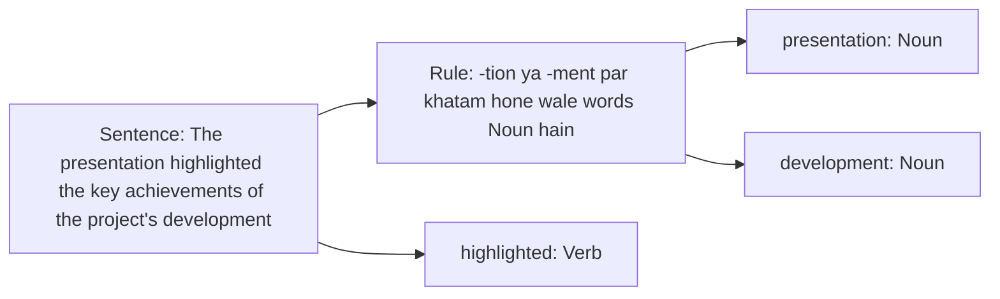

**i) Language model ki perplexity**

**In simple words:** perplexity batati hai ki language model ek text se kitna surprise hota hai. Perplexity jitni kam, model utna achha. <Cite id="class-nlp-pyq2" loc="p. 5" />

$$
\text{Perplexity}(P) = 2^{-\frac{1}{N}\sum_{i=1}^{N}\log_2 P(w_i \mid w_1, \dots, w_{i-1})}
$$

Perplexity 1 ideal score hai (perfect prediction); 1 se upar matlab thodi uncertainty; perplexity 10 matlab model utna uncertain hai jaise 10 possible words mein se chun raha ho. <Cite id="class-nlp-pyq2" loc="p. 5" />

<Sum>

<Given>

Q5a ke corpus (I am Sam, I like college, ...) ki bigram probabilities aur test sentence `<s>` I like college `</s>`.

</Given>

<Find>

perplexity.

</Find>

<Steps>

1. Probability $= P(I \mid \langle s\rangle)\,P(like \mid I)\,P(college \mid like)\,P(\langle/s\rangle \mid college) = \frac{3}{7} \times \frac{3}{6} \times \frac{3}{5} \times \frac{3}{3} = \frac{9}{70} = 0.1286$.
2. $N = 4$ predicted tokens (I, like, college, `</s>`).
3. $PP = (9/70)^{-1/4} = (70/9)^{1/4} = 7.778^{0.25} \approx 1.67$.

</Steps>

<Answer>

perplexity $\approx 1.67$.

</Answer>

<Box kind="verify">

$1.67^4 = 2.789^2 = 7.78 = 70/9$. 1 ke paas perplexity matlab model har word ke baare mein lagbhag sure hai.

</Box>

</Sum>

**ii) Rule based taggers**

**In simple words:** rule-based tagger har word ko hand-written rules follow karke uska part-of-speech tag deta hai.

**Definition:** rule-based POS tagging assigns POS tags based on predefined grammatical rules. Rules morphological features (jaise word endings) aur syntactic context se banaye jaate hain, isliye approach highly interpretable aur transparent hai. <Cite id="class-nlp-pyq3" loc="p. 3" />

Example: rule "-tion ya -ment par khatam hone wale words ko Noun do" presentation ko Noun aur development ko Noun tag karta hai, aur highlighted ko Verb. <Cite id="class-nlp-pyq3" loc="p. 3" /> <Cite id="class-nlp-pyq3" loc="p. 4" /> Rules haath se likhne padte hain, isliye wo har word cover nahi kar sakte (standard limit, class files mein nahi).

**Conclusion:** perplexity language model ko score karti hai (kam better hai); rule-based tagger predefined rules se words ko tag karta hai.
