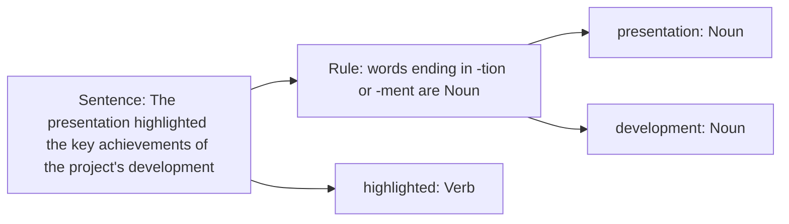

**i) Perplexity of a language model**

**In simple words:** perplexity tells how surprised a language model is by a text. The lower the perplexity, the better the model. <Cite id="class-nlp-pyq2" loc="p. 5" />

$$
\text{Perplexity}(P) = 2^{-\frac{1}{N}\sum_{i=1}^{N}\log_2 P(w_i \mid w_1, \dots, w_{i-1})}
$$

Perplexity 1 is the ideal score (perfect prediction); above 1 means some uncertainty; perplexity 10 means the model is as uncertain as if it chose between 10 possible words. <Cite id="class-nlp-pyq2" loc="p. 5" />

<Sum>

<Given>

the bigram probabilities of the corpus of Q5a (I am Sam, I like college, ...) and the test sentence `<s>` I like college `</s>`.

</Given>

<Find>

the perplexity.

</Find>

<Steps>

1. Probability $= P(I \mid \langle s\rangle)\,P(like \mid I)\,P(college \mid like)\,P(\langle/s\rangle \mid college) = \frac{3}{7} \times \frac{3}{6} \times \frac{3}{5} \times \frac{3}{3} = \frac{9}{70} = 0.1286$.
2. $N = 4$ predicted tokens (I, like, college, `</s>`).
3. $PP = (9/70)^{-1/4} = (70/9)^{1/4} = 7.778^{0.25} \approx 1.67$.

</Steps>

<Answer>

perplexity $\approx 1.67$.

</Answer>

<Box kind="verify">

$1.67^4 = 2.789^2 = 7.78 = 70/9$. A perplexity close to 1 means the model is almost sure of each word.

</Box>

</Sum>

**ii) Rule based taggers**

**In simple words:** a rule-based tagger gives each word its part-of-speech tag by following hand-written rules.

**Definition:** rule-based POS tagging assigns POS tags based on predefined grammatical rules. The rules are made from morphological features (like word endings) and syntactic context, so the approach is highly interpretable and transparent. <Cite id="class-nlp-pyq3" loc="p. 3" />

Example: the rule "assign Noun to words ending in -tion or -ment" tags presentation as Noun and development as Noun, and highlighted as Verb. <Cite id="class-nlp-pyq3" loc="p. 3" /> <Cite id="class-nlp-pyq3" loc="p. 4" /> The rules have to be written by hand, so they cannot cover every word (a standard limit, not in the class files).

**Conclusion:** perplexity scores a language model (lower is better); a rule-based tagger tags words with predefined rules.
