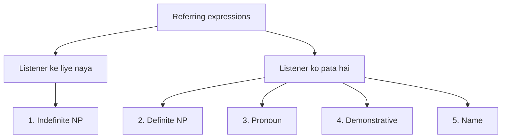

**In simple words:** reference resolution matlab ye dhoondhna ki *he*, *it* ya *the book* jaise words kis cheez ko point karte hain, taaki text ke sentences ek dusre se jud jaayein. <Cite id="class-nlp-asol" loc="p. 4" />

**Definition:** **referring expression** wo word ya phrase hai jo kisi insaan, object ya idea ko point karta hai. Uska **referent** wo cheez hai jise wo point karta hai; agar wo peeche ke kisi phrase ko point kare, to wo phrase **antecedent** hai. **Reference resolution** har referring expression ka referent dhoondhne ka kaam hai. Example: "Taylor went to the store. She bought groceries." mein *She* matlab *Taylor*. <Cite id="class-nlp-asol" loc="p. 1" />

| Type | Meaning | Example |
|---|---|---|
| 1. Indefinite noun phrase | Listener ke liye kuch naya (a, an, some) | Ram brought him **some food** |
| 2. Definite noun phrase | Known ya specific cheez (the) | I used to read **The Times of India** |
| 3. Pronoun | Pehle mention hue noun ki jagah | Ram laughed as loud as **he** could |
| 4. Demonstrative | Paas ya door ki cheez ko point karta hai: this, that, these, those | **This** is my book |
| 5. Name | Insaan, jagah ya cheez ka seedha naam | **Ram** laughed |

<Cite id="class-nlp-asol" loc="p. 4" /> <Cite id="class-nlp-asol" loc="p. 5" /> <Cite id="class-nlp-asol" loc="p. 6" />

**Conclusion:** indefinite phrase kuch naya laata hai; baaki chaar un cheezon ko point karte hain jo listener pehle se pehchaan sakta hai, aur resolution har ek ko uske referent se jodta hai.
