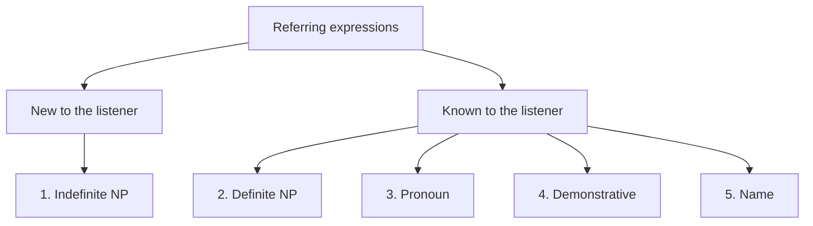

**In simple words:** reference resolution means finding which thing each word like *he*, *it* or *the book* points to, so the sentences of a text link up. <Cite id="class-nlp-asol" loc="p. 4" />

**Definition:** a **referring expression** is a word or phrase that points to a person, object or idea. Its **referent** is the thing it points to; if it points back to an earlier phrase, that phrase is the **antecedent**. **Reference resolution** is the task of finding the referent of every referring expression. Example: in "Taylor went to the store. She bought groceries.", *She* is *Taylor*. <Cite id="class-nlp-asol" loc="p. 1" />

| Type | Meaning | Example |
|---|---|---|
| 1. Indefinite noun phrase | Something new to the listener (a, an, some) | Ram brought him **some food** |
| 2. Definite noun phrase | Something known or specific (the) | I used to read **The Times of India** |
| 3. Pronoun | Stands in for a noun already mentioned | Ram laughed as loud as **he** could |
| 4. Demonstrative | Points to a near or far thing: this, that, these, those | **This** is my book |
| 5. Name | A direct name of a person, place or thing | **Ram** laughed |

<Cite id="class-nlp-asol" loc="p. 4" /> <Cite id="class-nlp-asol" loc="p. 5" /> <Cite id="class-nlp-asol" loc="p. 6" />

**Conclusion:** the indefinite phrase brings in something new; the other four point to things the listener can already identify, and resolution links each one to its referent.
