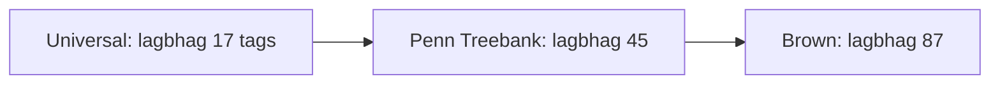

**In simple words:** POS tagging sentence ke har word par ek label lagata hai jo batata hai ki wo kis type ka word hai. Jo labels use kar sakte hain unki list **tagset** hai.

**Definition:** Parts of speech (PoS) tagging is a fundamental task in NLP where each word in a sentence is assigned a grammatical category such as noun, verb, adjective or adverb. <Cite id="class-nlp-pyq3" loc="p. 4" /> Example: The/DT quick/JJ brown/JJ fox/NN jumps/VBZ over/IN the/DT lazy/JJ dog/NN. <Cite id="class-nlp-pyq3" loc="p. 4" />

**Class mein use hua tagset:** Penn Treebank style tags. <Cite id="class-nlp-pyq3" loc="p. 1" /> <Cite id="class-nlp-pyq3" loc="p. 7" />

| Tag | Meaning | Tag | Meaning |
|---|---|---|---|
| NN | noun | DT | determiner |
| NNS | plural noun | JJ | adjective |
| NNP | proper noun | IN | preposition |
| VB | verb | TO | infinitive marker *to* |
| VBD | past-tense verb | PRP | pronoun |
| VBZ | verb (he, she, it form) | RB | adverb |
| MD | modal | | |

**Doosre tagsets** *(class files mein nahi; standard chhoti list)*:

1. **Penn Treebank tagset:** lagbhag 45 tags; NLP mein sabse zyada use hota hai.
2. **Brown corpus tagset:** purana, bada set, lagbhag 87 tags.
3. **CLAWS C5 aur C7 tagsets:** British National Corpus ke liye; C5 mein lagbhag 61 tags.
4. **Universal POS tagset:** 17 tags ka chhota common set (noun, verb, adjective, adverb, pronoun aadi) jo kai languages mein chalta hai.

**Conclusion:** POS tagging har word ko uski grammatical class ka label deta hai, aur tagset decide karta hai ki labels kitne detailed honge.
