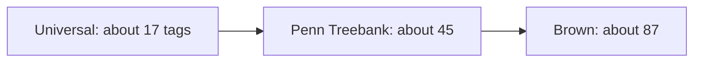

**In simple words:** POS tagging puts a label on every word of a sentence to say what kind of word it is. The list of labels you may use is the **tagset**.

**Definition:** Parts of speech (PoS) tagging is a fundamental task in NLP where each word in a sentence is assigned a grammatical category such as noun, verb, adjective or adverb. <Cite id="class-nlp-pyq3" loc="p. 4" /> Example: The/DT quick/JJ brown/JJ fox/NN jumps/VBZ over/IN the/DT lazy/JJ dog/NN. <Cite id="class-nlp-pyq3" loc="p. 4" />

**Tagset used in the class:** Penn Treebank style tags. <Cite id="class-nlp-pyq3" loc="p. 1" /> <Cite id="class-nlp-pyq3" loc="p. 7" />

| Tag | Meaning | Tag | Meaning |
|---|---|---|---|
| NN | noun | DT | determiner |
| NNS | plural noun | JJ | adjective |
| NNP | proper noun | IN | preposition |
| VB | verb | TO | infinitive marker *to* |
| VBD | past-tense verb | PRP | pronoun |
| VBZ | verb (he, she, it form) | RB | adverb |
| MD | modal | | |

**Other tagsets** *(not in the class files; standard short list)*:

1. **Penn Treebank tagset:** about 45 tags; the most used in NLP.
2. **Brown corpus tagset:** the older, larger set of about 87 tags.
3. **CLAWS C5 and C7 tagsets:** used for the British National Corpus; C5 has about 61 tags.
4. **Universal POS tagset:** a small common set of 17 tags (noun, verb, adjective, adverb, pronoun and so on) that works for many languages.

**Conclusion:** POS tagging labels each word with its grammatical class, and the tagset decides how fine the labels are.
