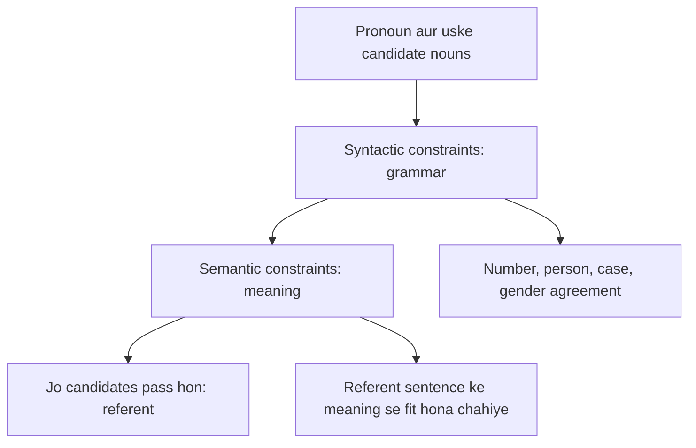

**In simple words:** text coherent tab hota hai jab uske sentences aapas mein jude hon, aur iske liye har pronoun ko aise noun ko point karna chahiye jo sach mein uska referent ho sake. Do tarah ke rules galat candidates hataate hain: syntactic (grammar) aur semantic (meaning). <Cite id="class-nlp-asol" loc="p. 1" /> *(Class files sirf agreement rules deti hain; baaki standard chhota answer hai. Question mein "coherence" likha hai; ye do constraints wala textbook topic coreference hai, isliye dono cover kiye hain.)*

**1. Syntactic constraints (grammar).** Pronoun aur antecedent agree karne chahiye: <Cite id="class-nlp-asol" loc="p. 4" />

- **Number:** singular ke saath singular, plural ke saath plural. "The chefs made lunch. **She** served it." galat hai, kyunki *She* singular hai aur *chefs* plural.
- **Person:** first (I), second (you), third (he, she, it, they) match hone chahiye.
- **Case:** *he* subject form hai, *him* object form, *his* owner form. "Ram saw **him**" mein *him* Ram nahi hai.
- **Gender:** *he* ke liye male antecedent chahiye. "John saw Mary, he greeted her" mein gender *Mary* ko *he* ke antecedent se hata deta hai.

**2. Semantic constraints (meaning).** Grammar do nouns ko allow kare, tab bhi sirf ek sense banata hai. "John parked the car in the garage. He drove **it** out" mein *it* car ya garage ho sakta hai, par chalaya sirf car jaata hai, isliye *it* car hai. Verb tay karta hai ki uski jagah kaisi cheez aa sakti hai (selection restriction).

| Constraint | Kya poochta hai | Example | Kya hataata hai |
|---|---|---|---|
| Syntactic (number) | Number mein agree karte hain? | The chefs ... She | chefs |
| Syntactic (gender) | Gender mein agree karte hain? | John saw Mary, he ... | Mary |
| Semantic | Meaning fit hota hai? | drove it out | the garage |

**Conclusion:** syntactic constraints grammar se candidates reject karte hain, semantic constraints meaning se; jo bachta hai wahi referent hai jo text ko coherent rakhta hai.
