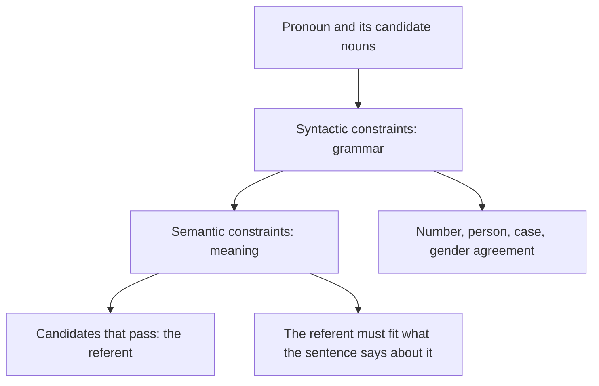

**In simple words:** a text is coherent when its sentences hang together, and that needs every pronoun to point to a noun that can really be its referent. Two kinds of rules cut the wrong candidates: syntactic (grammar) and semantic (meaning). <Cite id="class-nlp-asol" loc="p. 1" /> *(The class files give only the agreement rules; the rest is the standard short answer. The question says "coherence"; the textbook topic with these two constraints is coreference, so both are covered.)*

**1. Syntactic constraints (grammar).** The pronoun and its antecedent must agree: <Cite id="class-nlp-asol" loc="p. 4" />

- **Number:** singular with singular, plural with plural. "The chefs made lunch. **She** served it." is wrong, because *She* is singular and *chefs* is plural.
- **Person:** first (I), second (you), third (he, she, it, they) must match.
- **Case:** *he* is the subject form, *him* the object form, *his* the owner form. In "Ram saw **him**", *him* is not Ram.
- **Gender:** *he* needs a male antecedent. In "John saw Mary, he greeted her", gender removes *Mary* as the antecedent of *he*.

**2. Semantic constraints (meaning).** Even when grammar allows two nouns, only one makes sense. In "John parked the car in the garage. He drove **it** out", *it* can be the car or the garage, but only a car can be driven, so *it* is the car. The verb limits what kind of thing can fill its place (a selection restriction).

| Constraint | Question asked | Example | Removes |
|---|---|---|---|
| Syntactic (number) | Do they agree in number? | The chefs ... She | chefs |
| Syntactic (gender) | Do they agree in gender? | John saw Mary, he ... | Mary |
| Semantic | Does the meaning fit? | drove it out | the garage |

**Conclusion:** syntactic constraints reject candidates by grammar, semantic constraints reject them by meaning; what is left is the referent that keeps the text coherent.
