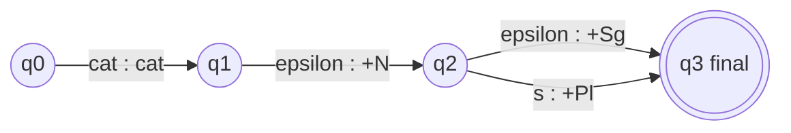

**In simple words:** finite state transducer (FST) ek chhoti machine hai jo word padhti hai aur uska analysis likhti hai. Wo *cats* padhti hai aur *cat + N + Pl* likhti hai.

**Definition:** FST, finite state automaton (FSA) ka extension hai jo input sequences ko output sequences se map karta hai. FSA sirf accept ya reject karta hai; FST input ko transform karta hai. Har transition mein ek input symbol aur ek output symbol hota hai, input : output likha jaata hai. <Cite id="class-nlp-pyq2" loc="p. 9" />

$T = (Q, \Sigma, \Gamma, q_0, F)$: $Q$ states ka finite set, $\Sigma$ input alphabet, $\Gamma$ output alphabet, $q_0$ initial state, $F$ final states. <Cite id="class-nlp-pyq2" loc="p. 9" />

**Ye kyun zaroori hai:** morphological parsing mein FST word ke surface form ko uske morphological representation (root ya stem plus noun, verb, singular, plural, tense) se map karta hai: surface word, phir FST, phir morphological analysis. <Cite id="class-nlp-pyq2" loc="p. 10" />

**Example par kaise chalta hai**

1. q0 se shuru karo, input *cats*. Stem *cat* padho aur output mein copy karo (cat : cat).
2. Kuch padhe bina noun tag +N likho (epsilon : +N).
3. *s* padho aur +Pl likho (s : +Pl). Agar padhne ko kuch na bacha ho, to doosra arc lo aur +Sg likho.
4. Final state mein ruk jao. Input *cats* ka output **cat + N + Pl**; input *cat* ka output **cat + N + Sg**. <Cite id="class-nlp-pyq2" loc="p. 10" />

| Input word | FST output |
|---|---|
| cat | cat + N + Sg |
| cats | cat + N + Pl |
| walked | walk + V + Past |
| went | go + V + Past |

*Went* se *go* isliye milta hai kyunki irregular form ke liye dictionary entry chahiye. <Cite id="class-nlp-pyq2" loc="p. 9" />

**Conclusion:** FST word padhkar uska analysis likhta hai; ulti direction mein chalao to analysis se word generate karta hai.
