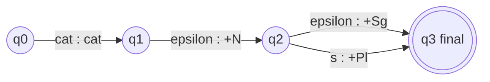

**In simple words:** a finite state transducer (FST) is a small machine that reads a word and writes its analysis. It reads *cats* and writes *cat + N + Pl*.

**Definition:** an FST is an extension of a finite state automaton (FSA) that maps input sequences to output sequences. An FSA only accepts or rejects an input; an FST transforms it. Every transition carries an input symbol and an output symbol, written input : output. <Cite id="class-nlp-pyq2" loc="p. 9" />

$T = (Q, \Sigma, \Gamma, q_0, F)$: $Q$ the finite set of states, $\Sigma$ the input alphabet, $\Gamma$ the output alphabet, $q_0$ the initial state, $F$ the final states. <Cite id="class-nlp-pyq2" loc="p. 9" />

**Why it is needed:** in morphological parsing the FST maps the surface form of a word to its morphological representation (root or stem plus noun, verb, singular, plural, tense): surface word, then FST, then morphological analysis. <Cite id="class-nlp-pyq2" loc="p. 10" />

**How it works on the example**

1. Start at q0 with the input *cats*. Read the stem *cat* and copy it to the output (cat : cat).
2. Write the noun tag +N without reading anything (epsilon : +N).
3. Read *s* and write +Pl (s : +Pl). If nothing is left to read, take the other arc and write +Sg.
4. Stop in the final state. Input *cats* gives output **cat + N + Pl**; input *cat* gives **cat + N + Sg**. <Cite id="class-nlp-pyq2" loc="p. 10" />

| Input word | FST output |
|---|---|
| cat | cat + N + Sg |
| cats | cat + N + Pl |
| walked | walk + V + Past |
| went | go + V + Past |

*Went* gives *go* because the irregular form needs a dictionary entry. <Cite id="class-nlp-pyq2" loc="p. 9" />

**Conclusion:** an FST reads a word and writes its analysis; run the other way it generates the word from the analysis.
