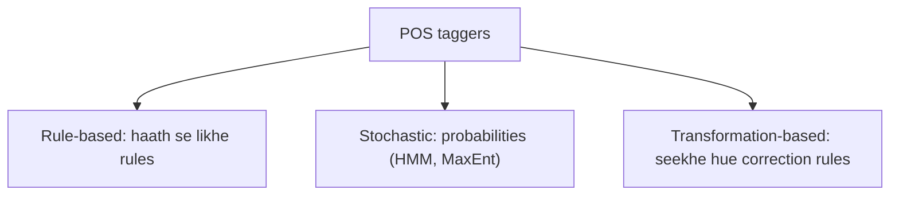
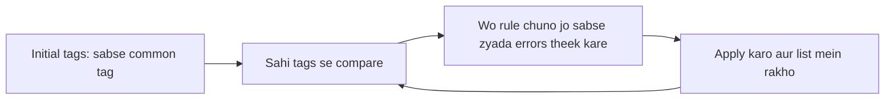

**In simple words:** POS tagging har word ko uski grammatical class ka label deta hai. Rule-based tagger un rules ko use karta hai jo insaan ne likhe hain. Transformation-based tagger pehle rough tag lagata hai, phir tagged corpus se seekhe rules se apni galtiyan theek karta hai.

**Definition:** Parts of speech (PoS) tagging is a fundamental task in NLP where each word in a sentence is assigned a grammatical category such as noun, verb, adjective or adverb. It helps machines understand the structure and meaning of sentences. Example: The/DT quick/JJ brown/JJ fox/NN jumps/VBZ over/IN the/DT lazy/JJ dog/NN. <Cite id="class-nlp-pyq3" loc="p. 4" />

**1. Rule-based tagging.** Ye predefined grammatical rules se POS tags deta hai. Rules word endings (morphology) aur aas-paas ke words (syntactic context) se bante hain, isliye method interpretable aur transparent hai. <Cite id="class-nlp-pyq3" loc="p. 3" />

*Example:* rule "-tion ya -ment par khatam hone wale words ko Noun tag do". "The presentation highlighted the key achievements of the project's development" mein *presentation*, *achievements* aur *development* noun ban jaate hain; *highlighted* ke liye doosra rule chahiye, jaise "-ed par khatam hone wala word verb hai". <Cite id="class-nlp-pyq3" loc="p. 3" /> <Cite id="class-nlp-pyq3" loc="p. 4" />

**2. Transformation-based (Brill) tagging.** *(Class files mein nahi; standard chhota answer.)* Ye apne rules haath se likhe jaane ki jagah tagged corpus se seekhta hai.

1. **Initial tagging:** har word ko uska sabse common tag do (jaise *race* NN, kyunki wo zyada baar noun hota hai).
2. **Compare:** training corpus mein dekho kahan tag sahi tag se alag hai.
3. **Transformation seekho:** "tag A ko B karo jab pichla tag C ho" form ka wo rule chuno jo sabse zyada errors theek kare, aur use apply karo.
4. **Repeat** karo jab tak koi rule kaafi madad na kare. Rules ki ordered list hi tagger hai.
5. **Naya text tag karo:** initial tags do, phir seekhe rules order mein apply karo.

*Example:* "to race". *race* ka initial tag NN hai, jo *to* ke baad galat hai. Seekha hua rule "NN ko VB karo jab pichla tag TO ho" deta hai to/TO race/VB.

| Point | Rule-based | Transformation-based |
|---|---|---|
| Rules kahan se | Experts likhte hain | Tagged corpus se seekhe jaate hain |
| Shuruaat | Seedhe rules | Most-common-tag guess, phir corrections |
| Padhne mein easy | Haan | Haan (chhote rules) |
| Kya chahiye | Language experts | Tagged corpus |

**Conclusion:** rule-based tagging haath ke rules lagata hai; transformation-based tagging correction rules data se seekhta hai aur rules ki readability rakhta hai.
