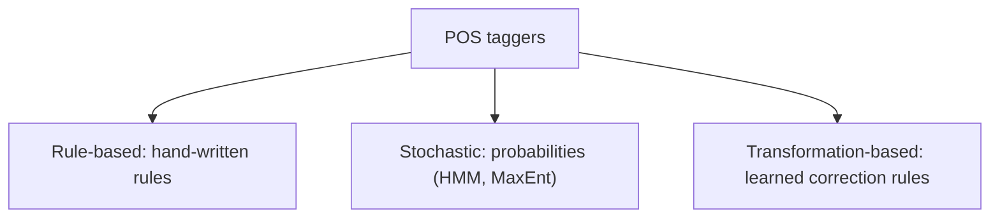
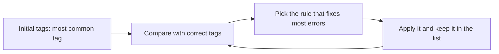

**In simple words:** POS tagging labels every word with its grammatical class. A rule-based tagger uses rules written by people. A transformation-based tagger first tags roughly, then fixes its mistakes with rules it learned from a tagged corpus.

**Definition:** Parts of speech (PoS) tagging is a fundamental task in NLP where each word in a sentence is assigned a grammatical category such as noun, verb, adjective or adverb. It helps machines understand the structure and meaning of sentences. Example: The/DT quick/JJ brown/JJ fox/NN jumps/VBZ over/IN the/DT lazy/JJ dog/NN. <Cite id="class-nlp-pyq3" loc="p. 4" />

**1. Rule-based tagging.** It assigns POS tags using predefined grammatical rules. The rules are built from word endings (morphology) and the words around (syntactic context), so the method is interpretable and transparent. <Cite id="class-nlp-pyq3" loc="p. 3" />

*Example:* the rule "assign Noun to words ending in -tion or -ment". In "The presentation highlighted the key achievements of the project's development", *presentation*, *achievements* and *development* become nouns; *highlighted* needs a second rule, such as "a word ending in -ed is a verb". <Cite id="class-nlp-pyq3" loc="p. 3" /> <Cite id="class-nlp-pyq3" loc="p. 4" />

**2. Transformation-based (Brill) tagging.** *(Not in the class files; standard short answer.)* It learns its rules from a tagged corpus instead of having them written by hand.

1. **Initial tagging:** give every word its most common tag (for example *race* is NN, because it is a noun more often).
2. **Compare:** find the places where the tag differs from the correct tag in the training corpus.
3. **Learn a transformation:** pick the rule of the form "change tag A to B when the previous tag is C" that fixes the most errors, and apply it.
4. **Repeat** until no rule helps enough. The ordered list of rules is the tagger.
5. **Tag new text:** give the initial tags, then apply the learned rules in order.

*Example:* "to race". The initial tag of *race* is NN, which is wrong after *to*. The learned rule "change NN to VB when the previous tag is TO" gives to/TO race/VB.

| Point | Rule-based | Transformation-based |
|---|---|---|
| Rules come from | Written by experts | Learned from a tagged corpus |
| Starts with | The rules directly | A most-common-tag guess, then corrections |
| Easy to read | Yes | Yes (short rules) |
| Needs | Language experts | A tagged corpus |

**Conclusion:** rule-based tagging applies hand-made rules; transformation-based tagging learns its correction rules from data and keeps the readability of rules.
