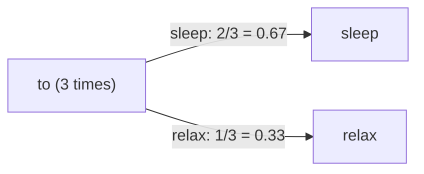

**In simple words:** dekho `to` ke baad kaunsa word kitni baar aata hai; sabse zyada baar aane wala word hi prediction hai.

**Formula:** $P(B \mid A) = \text{count}(AB) / \text{count}(A)$. <Cite id="class-nlp-m2" loc="p. 9" />

<Sum>

<Given>

Corpus: `<s>` I tell you to sleep rest `</s>`; `<s>` I would like to sleep for an hour `</s>`; `<s>` Sleep helps one to relax `</s>`. Dhyan do: sentence 1 mein *and* nahi hai (class wale version se alag). <Cite id="class-nlp-pyq2" loc="p. 7" />

</Given>

<Find>

saare bigrams, unki conditional probabilities, aur **to** ke baad ka next word.

</Find>

<Steps>

1. **Unigram counts:** `<s>` 3, I 2, tell 1, you 1, to 3, sleep 2, rest 1, would 1, like 1, for 1, an 1, hour 1, Sleep 1, helps 1, one 1, relax 1, `</s>` 3. (25 tokens: 8 + 10 + 7.) *Sleep* (capital S) aur *sleep* alag tokens gine gaye hain, class solution ki tarah.
2. **Bigrams:** 25 tokens minus 3 sentences gives 22 bigrams (20 alag-alag; `<s> I` aur `to sleep` do baar aate hain). With $P(B \mid A) = \text{count}(AB)/\text{count}(A)$:

Table mein n(AB) = count(AB), n(A) = count(A) aur P = P(B given A).

| Bigram AB | n(AB) | n(A) | P |
|---|---|---|---|
| `<s>` I | 2 | 3 | 2/3 = 0.67 |
| I tell | 1 | 2 | 1/2 = 0.50 |
| tell you | 1 | 1 | 1 = 1.00 |
| you to | 1 | 1 | 1 = 1.00 |
| to sleep | 2 | 3 | 2/3 = 0.67 |
| sleep rest | 1 | 2 | 1/2 = 0.50 |
| rest `</s>` | 1 | 1 | 1 = 1.00 |
| I would | 1 | 2 | 1/2 = 0.50 |
| would like | 1 | 1 | 1 = 1.00 |
| like to | 1 | 1 | 1 = 1.00 |
| sleep for | 1 | 2 | 1/2 = 0.50 |
| for an | 1 | 1 | 1 = 1.00 |
| an hour | 1 | 1 | 1 = 1.00 |
| hour `</s>` | 1 | 1 | 1 = 1.00 |
| `<s>` Sleep | 1 | 3 | 1/3 = 0.33 |
| Sleep helps | 1 | 1 | 1 = 1.00 |
| helps one | 1 | 1 | 1 = 1.00 |
| one to | 1 | 1 | 1 = 1.00 |
| to relax | 1 | 3 | 1/3 = 0.33 |
| relax `</s>` | 1 | 1 | 1 = 1.00 |

3. **to ke baad** (to 3 baar aata hai): sleep 2/3 = 0.67, relax 1/3 = 0.33.

</Steps>

<Answer>

**to** ke baad ka next word **sleep** hai (2/3 = 0.67).

</Answer>

<Box kind="verify">

2/3 + 1/3 = 1, isliye *to* ke baad ki probabilities ka sum 1 hai. Bigram counts ka sum 2 + 1 + 1 + 1 + 2 + 1 + 1 + 1 + 1 + 1 + 1 + 1 + 1 + 1 + 1 + 1 + 1 + 1 + 1 + 1 = 22 hai, jo 25 - 3 ke barabar hai. Class corpus se *and* hataane par `sleep and` aur `and rest` bigrams jaate hain aur `sleep rest` aata hai, isliye 23 se 22 ho jaate hain; answer wahi rehta hai, kyunki *to* ke baad wahi words aate hain.

</Box>

</Sum>

**Conclusion:** "to" ke baad model "sleep" predict karta hai.
