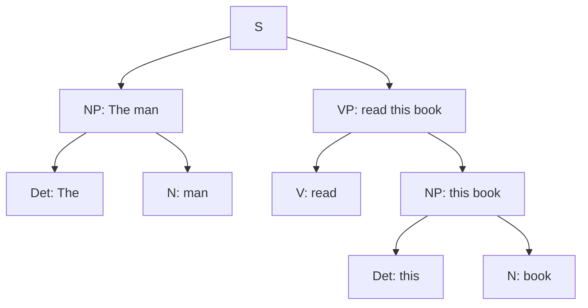

**In simple words:** constituent words ka wo group hai jo sentence mein ek unit ki tarah kaam karta hai. "The man read this book" mein *The man* ek unit hai (ise *He* se badla ja sakta hai) aur *read this book* doosra. Context-free grammar (CFG) mein har tarah ke unit ke liye ek rule hota hai. *(Class files constituency define nahi karti; sirf neeche wala grammar aur tree deti hain. Baaki standard chhota answer hai.)*

**Definition:** **constituent** ek word ya words ka group hai jo ek unit ki tarah behave karta hai aur jiska grammatical label hota hai, jaise NP (noun phrase), VP (verb phrase) ya PP (prepositional phrase). CFG constituency describe karta hai: NP $\to$ Det N jaisa har rule batata hai ki constituent kis se bana hai, aur parse tree dikhata hai ki chhote constituents milkar bade kaise bante hain.

**Class grammar ke saath example** <Cite id="class-nlp-pyq3" loc="p. 8" />: S $\to$ NP VP, NP $\to$ Det N | N, VP $\to$ V NP, Det $\to$ The | this, N $\to$ man | book, V $\to$ read.

Yahan constituents: *The man* (NP), *this book* (NP), *read this book* (VP) aur poora sentence (S). *man read* constituent nahi hai: koi rule use nahi banata.

**Constituent ke tests** *(standard)*:

| Test | Example | Result |
|---|---|---|
| Substitution: pronoun se badlo | The man read this book se **He** read it | The man aur this book units hain |
| Akele answer ho sake | What did he do? Read this book | read this book unit hai |
| Movement: block ki tarah move ho | This book, the man read | this book unit hai |

**Constituency kyun important hai:** wahi words do tarah se group ho sakte hain, to ek sentence ke do trees ban jaate hain. "I saw the man with the telescope" ambiguous hai: ya to *the man with the telescope* ek NP hai (telescope aadmi ke paas hai), ya *with the telescope* VP ke andar PP hai (maine use kiya). <Cite id="class-nlp-pyq4" loc="p. 6" />

**Conclusion:** CFG sentence ko constituents se banata hai, aur parse tree dikhata hai ki kaunse words saath hain.
