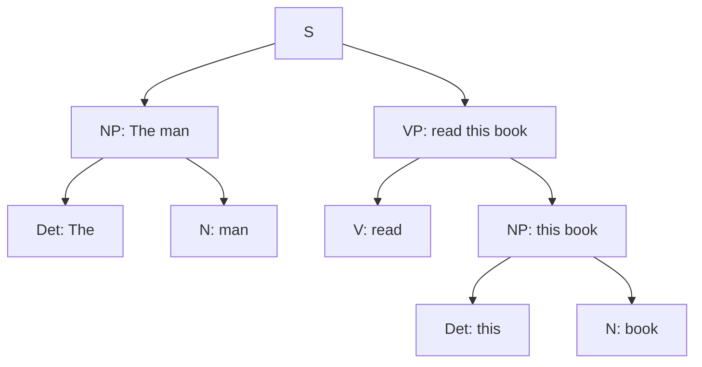

**In simple words:** a constituent is a group of words that works as one unit in a sentence. In "The man read this book", *The man* is one unit (it can be replaced by *He*) and *read this book* is another. A context-free grammar (CFG) has one rule for each kind of unit. *(The class files do not define constituency; they only give the grammar and tree used below. The rest is the standard short answer.)*

**Definition:** a **constituent** is a word or a group of words that behaves as a single unit and has a grammatical label such as NP (noun phrase), VP (verb phrase) or PP (prepositional phrase). A CFG describes constituency: each rule such as NP $\to$ Det N says what a constituent is made of, and the parse tree shows how smaller constituents join into bigger ones.

**Example with the class grammar** <Cite id="class-nlp-pyq3" loc="p. 8" />: S $\to$ NP VP, NP $\to$ Det N | N, VP $\to$ V NP, Det $\to$ The | this, N $\to$ man | book, V $\to$ read.

Constituents here: *The man* (NP), *this book* (NP), *read this book* (VP) and the whole sentence (S). *man read* is not a constituent: no rule builds it.

**Tests for a constituent** *(standard)*:

| Test | Example | Result |
|---|---|---|
| Substitution: replace it by a pronoun | The man read this book becomes **He** read it | The man and this book are units |
| Answer alone: it can answer a question | What did he do? Read this book | read this book is a unit |
| Movement: it moves as a block | This book, the man read | this book is a unit |

**Why constituency matters:** the same words can group in two ways, so the same sentence gets two trees. "I saw the man with the telescope" is ambiguous: either *the man with the telescope* is one NP (the man has it), or *with the telescope* is a PP inside the VP (I used it). <Cite id="class-nlp-pyq4" loc="p. 6" />

**Conclusion:** a CFG builds a sentence from constituents, and the parse tree shows which words belong together.
