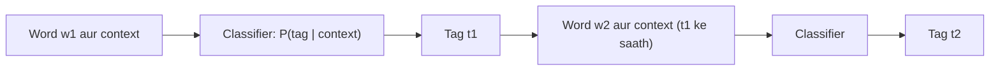

**In simple words:** sequence labelling sequence ke har item ko ek label deta hai, jaise har word ko ek POS tag. Classification method ye aise karta hai ki har word ko ek chhoti classification problem maanta hai: word aur uske neighbours dekho, phir best tag chuno. <Cite id="class-nlp-pyq3" loc="p. 8" />

**Sequence labelling:** input words ki sequence $W = (w_1, \ldots, w_n)$ hai aur output labels ki sequence $T = (t_1, \ldots, t_n)$, har word ke liye ek. Uses: POS tagging (noun, verb) aur named entity recognition (person, place). Labels apne neighbours par depend karte hain, isliye order matter karta hai. *(Class files idea ek line mein deti hain; baaki unke MaxEnt answer ko follow karta hai.)*

**Classification method (Maximum Entropy).** Maximum Entropy (MaxEnt) model, jise multinomial logistic regression bhi kehte hain, discriminative model hai: ye seedha $P(y \mid x)$ model karta hai, yaani context $x$ diye hone par tag $y$ ka chance. <Cite id="class-nlp-pyq3" loc="p. 8" />

1. Har word ke liye context $x$ banao: word, uske neighbours aur pehle chune hue tags.
2. Binary **feature functions** $f_i(x, y)$ nikalo (condition sach ho to 1). <Cite id="class-nlp-pyq3" loc="p. 9" />
3. Har tag ko score do: $P(y \mid x) = \frac{1}{Z(x)} \exp\big(\sum_i \lambda_i f_i(x, y)\big)$, jahan $\lambda_i$ seekhe hue weights hain aur $Z(x)$ probabilities ka sum 1 karta hai. <Cite id="class-nlp-pyq3" loc="p. 9" />
4. Sabse zyada probability wala tag chuno, agle word par jao aur repeat karo. Poore sentence par ye MaxEnt Markov Model hai, $P(T \mid W) = \prod_i P(t_i \mid x_i)$, jise Viterbi se decode karte hain. <Cite id="class-nlp-pyq3" loc="p. 10" />

**Example (numbers formula samjhane ke liye banaye hain).** Tag TO ke baad word *run* ko tag karo. Weights: "word is run and tag is VB" ke liye 2, "previous tag is TO and tag is VB" ke liye 1.5, "word is run and tag is NN" ke liye 1.

- Score(VB) = 2 + 1.5 = 3.5 aur Score(NN) = 1.
- $P(\text{VB}) = e^{3.5} / (e^{3.5} + e^{1}) = 33.12 / 35.83 = 0.92$ aur $P(\text{NN}) = 0.08$.
- *run* ko VB tag milta hai: "to/TO run/VB".

| Point | Classification (MaxEnt) | HMM |
|---|---|---|
| Models | $P(y \mid x)$, discriminative | $P(x, y)$, generative |
| Features | Rich, overlapping | Sirf word aur previous tag |
| Weakness | Label bias, iterative training | Extra features nahi jod sakte |

**Conclusion:** sequence labelling sequence ke har item ko tag karta hai; classification method har tag ko context ke weighted features se chunta hai.
