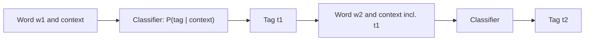

**In simple words:** sequence labelling gives one label to every item of a sequence, for example one POS tag to every word. The classification method does it by treating each word as a small classification problem: look at the word and its neighbours, then pick the best tag. <Cite id="class-nlp-pyq3" loc="p. 8" />

**Sequence labelling:** the input is a sequence of words $W = (w_1, \ldots, w_n)$ and the output is a sequence of labels $T = (t_1, \ldots, t_n)$, one per word. Uses: POS tagging (noun, verb) and named entity recognition (person, place). Labels depend on their neighbours, so the order matters. *(The class files give the idea in one line; the rest follows their MaxEnt answer.)*

**Classification method (Maximum Entropy).** The Maximum Entropy (MaxEnt) model, also known as multinomial logistic regression, is a discriminative model: it directly models $P(y \mid x)$, the chance of tag $y$ given the context $x$. <Cite id="class-nlp-pyq3" loc="p. 8" />

1. For each word, build the context $x$: the word, its neighbours and the tags already chosen.
2. Compute binary **feature functions** $f_i(x, y)$ (1 if the condition holds). <Cite id="class-nlp-pyq3" loc="p. 9" />
3. Score every tag: $P(y \mid x) = \frac{1}{Z(x)} \exp\big(\sum_i \lambda_i f_i(x, y)\big)$, where $\lambda_i$ are learned weights and $Z(x)$ makes the probabilities add to 1. <Cite id="class-nlp-pyq3" loc="p. 9" />
4. Pick the tag with the highest probability, move to the next word and repeat. Over a whole sentence this is the MaxEnt Markov Model, $P(T \mid W) = \prod_i P(t_i \mid x_i)$, decoded with Viterbi. <Cite id="class-nlp-pyq3" loc="p. 10" />

**Example (numbers made up to show the formula).** Tag the word *run* after the tag TO. Weights: 2 for "word is run and tag is VB", 1.5 for "previous tag is TO and tag is VB", 1 for "word is run and tag is NN".

- Score(VB) = 2 + 1.5 = 3.5 and Score(NN) = 1.
- $P(\text{VB}) = e^{3.5} / (e^{3.5} + e^{1}) = 33.12 / 35.83 = 0.92$ and $P(\text{NN}) = 0.08$.
- *run* is tagged VB: "to/TO run/VB".

| Point | Classification (MaxEnt) | HMM |
|---|---|---|
| Models | $P(y \mid x)$, discriminative | $P(x, y)$, generative |
| Features | Rich, overlapping | Only word and previous tag |
| Weakness | Label bias, iterative training | Cannot add extra features |

**Conclusion:** sequence labelling tags every item of a sequence; the classification method picks each tag from weighted features of the context.
