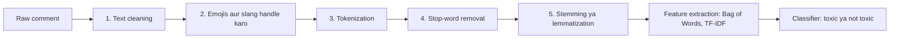

**In simple words:** toxic word identification ek text classification task hai: decide karo ki comment mein abuse ya hate hai ya nahi. Comments messy hote hain, isliye classifier ko dene se pehle unhe clean karke tokens mein kaata jaata hai. *(Class files mein toxic-comment ka example nahi hai; neeche ke steps text classification aur sentiment analysis ke class pre-processing steps hain, jo is task par lagaye gaye hain. "Extra" wale points class files mein nahi hain.)*

**Definition:** data preprocessing is cleaning a text before giving it to computers. <Cite id="class-nlp-m2" loc="p. 19" /> Text classification text ko predefined labels deta hai, yahan *toxic* ya *not toxic*. <Cite id="class-nlp-m6" loc="slide 18" />

**Pre-processing steps** <Cite id="class-nlp-m6" loc="slide 33" /> <Cite id="class-nlp-asol" loc="p. 11" /> <Cite id="class-nlp-asol" loc="p. 12" />

1. **Text cleaning:** HTML tags, special characters, numbers aur links hatao, taaki sirf words bachein.
2. **Emojis aur slang handle karo:** emoji ko word banao (angry face se *angry*) aur slang ko normal word se map karo, kyunki abuse aksar slang mein likha hota hai. Commas, periods aur extra symbols hatao (term normalization).
3. **Case normalization aur tokenization:** sab kuch lowercase karo, taaki *IDIOT* aur *idiot* match karein, phir text ko tokens (words) mein todo.
4. **Stop-word removal:** *the*, *is*, *a*, *and*, *in* jaise bahut common words hatao, jinka toxic meaning nahi hota aur wo sirf noise badhate hain.
5. **Stemming ya lemmatization:** har word ko uske base par laao (idiots se idiot), taaki ek toxic word apne saare forms mein match ho.

**Extra (class files mein nahi):** *not* jaise negations rakho, kyunki "not good" ka meaning badal deta hai; aur *id1ot* ya *stuuupid* jaisi disguised spellings ko asli word par map karo.

**Example**

| Step | Output |
|---|---|
| Raw comment | `
You are SO stupid!!! Such an idiot 😡
` |
| Text cleaning | You are SO stupid!!! Such an idiot 😡 |
| Emoji se word, lowercase, punctuation hata | you are so stupid such an idiot angry |
| Tokenization | you, are, so, stupid, such, an, idiot, angry |
| Stop-words hataye | stupid, idiot, angry |

Tokens *stupid*, *idiot* aur *angry* ko phir toxic words ki list se match kiya jaata hai ya classifier ko diya jaata hai, jo comment ko toxic label karta hai.

**Conclusion:** pre-processing messy comment ko kuch clean tokens mein badal deta hai, taaki classifier toxic words ko bharosemand tareeke se pakad sake.
