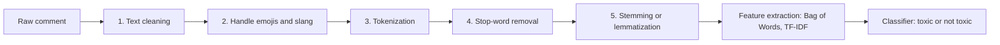

**In simple words:** toxic word identification is a text classification task: decide whether a comment contains abuse or hate. Comments are messy, so they are cleaned and cut into tokens before the classifier sees them. *(The class files give no toxic-comment example; the steps below are the class pre-processing steps for text classification and sentiment analysis, applied to this task. Points marked "extra" are not in the class files.)*

**Definition:** data preprocessing is cleaning a text before giving it to computers. <Cite id="class-nlp-m2" loc="p. 19" /> Text classification assigns predefined labels to text, here *toxic* or *not toxic*. <Cite id="class-nlp-m6" loc="slide 18" />

**Pre-processing steps** <Cite id="class-nlp-m6" loc="slide 33" /> <Cite id="class-nlp-asol" loc="p. 11" /> <Cite id="class-nlp-asol" loc="p. 12" />

1. **Text cleaning:** remove HTML tags, special characters, numbers and links, so only words remain.
2. **Handle emojis and slang:** turn an emoji into a word (an angry face becomes *angry*) and map slang to the normal word, because abuse is often written in slang. Remove commas, periods and extra symbols (term normalization).
3. **Case normalization and tokenization:** make everything lowercase, so *IDIOT* and *idiot* match, then split the text into tokens (words).
4. **Stop-word removal:** drop very common words such as *the*, *is*, *a*, *and*, *in*, which carry no toxic meaning and only add noise.
5. **Stemming or lemmatization:** reduce each word to its base (idiots to idiot), so one toxic word matches in all its forms.

**Extra (not in the class files):** keep negations such as *not*, because "not good" changes the meaning; and also map disguised spellings such as *id1ot* or *stuuupid* back to the real word.

**Example**

| Step | Output |
|---|---|
| Raw comment | `
You are SO stupid!!! Such an idiot 😡
` |
| Text cleaning | You are SO stupid!!! Such an idiot 😡 |
| Emoji to word, lowercase, no punctuation | you are so stupid such an idiot angry |
| Tokenization | you, are, so, stupid, such, an, idiot, angry |
| Stop-words removed | stupid, idiot, angry |

The tokens *stupid*, *idiot* and *angry* are then matched against a list of toxic words or passed to the classifier, which labels the comment toxic.

**Conclusion:** pre-processing turns a messy comment into a few clean tokens, so the classifier can spot toxic words reliably.
