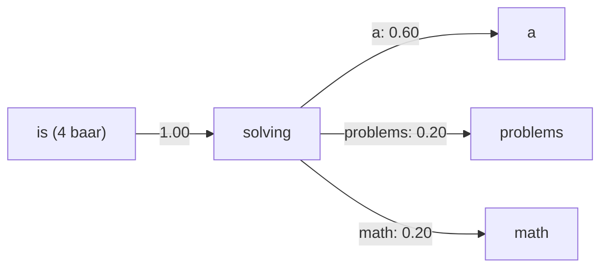

**In simple words:** pehle wala hi method: har word gino, har pair gino, divide karo, sabse bada chuno.

**Formula:** $P(B \mid A) = \text{count}(AB) / \text{count}(A)$. <Cite id="class-nlp-m2" loc="p. 9" />

<Sum>

<Given>

Corpus: `<s>` Four students Ravi, Ramesh, Rekha and Rita are solving problems `</s>`; `<s>` Ravi is solving math problems `</s>`; `<s>` Ramesh is solving a logic puzzle `</s>`; `<s>` Rekha is solving a hard problem `</s>`; `<s>` Rita is solving a puzzle with patience `</s>`. Commas hata diye gaye hain (wo punctuation hain, words nahi), jaise preprocessing mein hota hai. <Cite id="class-nlp-qb1" loc="Module 02, Q4" />

</Given>

<Find>

saare bigrams, unki conditional probabilities, aur **solving** aur **is** ke baad ka agla word.

</Find>

<Steps>

1. **Unigram counts** (5 sentences, 44 tokens): `<s>` 5, Four 1, students 1, Ravi 2, Ramesh 2, Rekha 2, and 1, Rita 2, are 1, solving 5, problems 2, `</s>` 5, is 4, math 1, a 3, logic 1, puzzle 2, hard 1, problem 1, with 1, patience 1.
2. **Bigrams:** 44 tokens minus 5 sentences se 39 bigrams, jinme 33 alag hain. $P(B \mid A) = \text{count}(AB)/\text{count}(A)$ se:

Table mein n(AB) = count(AB), n(A) = count(A) aur P = P(B given A).

| Bigram AB | n(AB) | n(A) | P |
|---|---|---|---|
| `<s>` Four | 1 | 5 | 1/5 = 0.20 |
| Four students | 1 | 1 | 1 = 1.00 |
| students Ravi | 1 | 1 | 1 = 1.00 |
| Ravi Ramesh | 1 | 2 | 1/2 = 0.50 |
| Ramesh Rekha | 1 | 2 | 1/2 = 0.50 |
| Rekha and | 1 | 2 | 1/2 = 0.50 |
| and Rita | 1 | 1 | 1 = 1.00 |
| Rita are | 1 | 2 | 1/2 = 0.50 |
| are solving | 1 | 1 | 1 = 1.00 |
| solving problems | 1 | 5 | 1/5 = 0.20 |
| problems `</s>` | 2 | 2 | 1 = 1.00 |
| `<s>` Ravi | 1 | 5 | 1/5 = 0.20 |
| Ravi is | 1 | 2 | 1/2 = 0.50 |
| is solving | 4 | 4 | 1 = 1.00 |
| solving math | 1 | 5 | 1/5 = 0.20 |
| math problems | 1 | 1 | 1 = 1.00 |
| `<s>` Ramesh | 1 | 5 | 1/5 = 0.20 |
| Ramesh is | 1 | 2 | 1/2 = 0.50 |
| solving a | 3 | 5 | 3/5 = 0.60 |
| a logic | 1 | 3 | 1/3 = 0.33 |
| logic puzzle | 1 | 1 | 1 = 1.00 |
| puzzle `</s>` | 1 | 2 | 1/2 = 0.50 |
| `<s>` Rekha | 1 | 5 | 1/5 = 0.20 |
| Rekha is | 1 | 2 | 1/2 = 0.50 |
| a hard | 1 | 3 | 1/3 = 0.33 |
| hard problem | 1 | 1 | 1 = 1.00 |
| problem `</s>` | 1 | 1 | 1 = 1.00 |
| `<s>` Rita | 1 | 5 | 1/5 = 0.20 |
| Rita is | 1 | 2 | 1/2 = 0.50 |
| a puzzle | 1 | 3 | 1/3 = 0.33 |
| puzzle with | 1 | 2 | 1/2 = 0.50 |
| with patience | 1 | 1 | 1 = 1.00 |
| patience `</s>` | 1 | 1 | 1 = 1.00 |

3. **solving ke baad** (5 baar): a 3/5 = 0.60, problems 1/5 = 0.20, math 1/5 = 0.20.
4. **is ke baad** (4 baar): solving 4/4 = 1.

</Steps>

<Answer>

**solving** ke baad agla word = **a** (0.60). **is** ke baad agla word = **solving** (1.00).

</Answer>

<Box kind="verify">

solving ke baad: 3/5 + 1/5 + 1/5 = 1. is ke baad: 4/4 = 1. Counts ka sum 39 = 44 - 5 bigrams.

</Box>

</Sum>

**Conclusion:** model "solving" ke baad "a" aur "is" ke baad "solving" predict karta hai.
