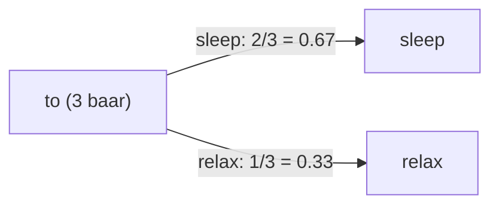

**In simple words:** gino ki "to" ke baad kaun sa word kitni baar aata hai; sabse zyada aane wala hi prediction hai.

**Formula:** $P(B \mid A) = \text{count}(AB) / \text{count}(A)$. <Cite id="class-nlp-m2" loc="p. 9" />

<Sum>

<Given>

Corpus: `<s>` I tell you to sleep and rest `</s>`; `<s>` I would like to sleep for an hour `</s>`; `<s>` Sleep helps one to relax `</s>`. <Cite id="class-nlp-pyq2" loc="p. 7" />

</Given>

<Find>

bigrams, unki conditional probabilities, aur **to** ke baad ka agla word.

</Find>

<Steps>

1. **Unigram counts:** `<s>` 3, I 2, tell 1, you 1, to 3, sleep 2, and 1, rest 1, would 1, like 1, for 1, an 1, hour 1, Sleep 1, helps 1, one 1, relax 1, `</s>` 3. (26 tokens.)
2. **Bigrams:** 26 tokens minus 3 sentences se 23 bigrams (21 alag; `<s> I` aur to sleep do-do baar aaye). $P(B \mid A) = \text{count}(AB)/\text{count}(A)$ se:

Table mein n(AB) = count(AB), n(A) = count(A) aur P = P(B given A).

| Bigram AB | n(AB) | n(A) | P |
|---|---|---|---|
| `<s>` I | 2 | 3 | 2/3 = 0.67 |
| I tell | 1 | 2 | 1/2 = 0.50 |
| tell you | 1 | 1 | 1 = 1.00 |
| you to | 1 | 1 | 1 = 1.00 |
| to sleep | 2 | 3 | 2/3 = 0.67 |
| sleep and | 1 | 2 | 1/2 = 0.50 |
| and rest | 1 | 1 | 1 = 1.00 |
| rest `</s>` | 1 | 1 | 1 = 1.00 |
| I would | 1 | 2 | 1/2 = 0.50 |
| would like | 1 | 1 | 1 = 1.00 |
| like to | 1 | 1 | 1 = 1.00 |
| sleep for | 1 | 2 | 1/2 = 0.50 |
| for an | 1 | 1 | 1 = 1.00 |
| an hour | 1 | 1 | 1 = 1.00 |
| hour `</s>` | 1 | 1 | 1 = 1.00 |
| `<s>` Sleep | 1 | 3 | 1/3 = 0.33 |
| Sleep helps | 1 | 1 | 1 = 1.00 |
| helps one | 1 | 1 | 1 = 1.00 |
| one to | 1 | 1 | 1 = 1.00 |
| to relax | 1 | 3 | 1/3 = 0.33 |
| relax `</s>` | 1 | 1 | 1 = 1.00 |

3. **to ke baad** (to 3 baar aaya): sleep 2/3 = 0.67, relax 1/3 = 0.33.

</Steps>

<Answer>

**to** ke baad agla word **sleep** hai (2/3 = 0.67).

</Answer>

<Box kind="verify">

2/3 + 1/3 = 1. 23 bigrams typed class solution se match karte hain, jo sleep 0.667 aur relax 0.333 deta hai. (Handwritten notes mein sleep ke liye 1/3 likha tha, jo galat hai: sleep do sentences mein to ke baad aaya.) <Cite id="class-nlp-pyq2" loc="p. 7" /> <Cite id="class-nlp-m2" loc="p. 17" />

</Box>

</Sum>

**Conclusion:** "to" ke baad model "sleep" predict karta hai.
