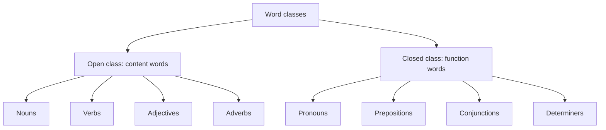
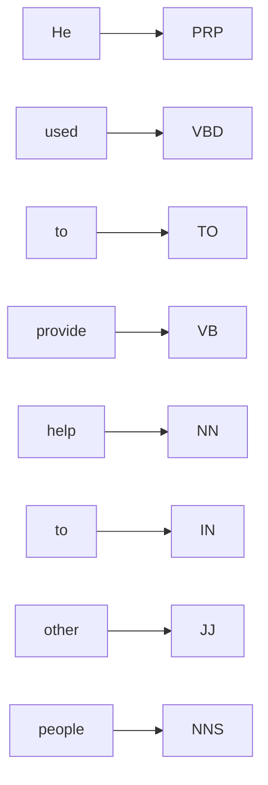

**In simple words:** words ko unke kaam ke hisaab se classes mein baanta jaata hai. Kuch classes mein naye words judte rehte hain (open), baaki ek chhoti fixed list hoti hain (closed). Phir tagging har word ko uski class ka label deti hai. <Cite id="class-nlp-pyq3" loc="p. 1" />

**Open class words:** ye wo words hain jinme naye words aur changes aasani se jud jaate hain. Ye aam taur par content words hote hain jo meaning dete hain, jaise nouns, verbs, adjectives aur adverbs. Language badalne ke saath ye classes badhti rehti hain. <Cite id="class-nlp-pyq3" loc="p. 1" />

- Nouns: book, dog, computer
- Verbs: run, eat, sleep
- Adjectives: big, red, happy
- Adverbs: quickly, softly, beautifully

**Closed class words:** inme naye members aasani se nahi judte. Ye aksar function words hote hain jo grammar ka kaam karte hain aur sentence ke andar structure ka relation dikhate hain. Ye classes kaafi stable hain aur time ke saath mushkil se badalti hain. <Cite id="class-nlp-pyq3" loc="p. 1" />

- Pronouns: he, she, it, they
- Prepositions: on, in, at, with
- Conjunctions: and, but, or, so
- Determiners: the, a, an, some (articles *the, a, an* determiners hi hain)

| Point | Open class | Closed class |
|---|---|---|
| Naye words | Aasani se jude | Lagbhag kabhi nahi |
| Kisam ke words | Content words (meaning) | Function words (grammar) |
| Examples | book, run, big, quickly | he, on, and, the |

**"He used to provide help to other people." ko tag karna.** Har word ko wo tag milta hai jo yahan uska kaam hai. <Cite id="class-nlp-pyq3" loc="p. 1" />

| Word | POS tag | Word class |
|---|---|---|
| He | PRP | Pronoun |
| used | VBD | Verb (past tense) |
| to | TO | Infinitive marker |
| provide | VB | Verb |
| help | NN | Noun |
| to | IN | Preposition |
| other | JJ | Adjective |
| people | NNS | Plural noun |

*Ye tags kyun:* *used* past-tense verb hai; pehla *to* verb *provide* se pehle hai, isliye infinitive marker hai; *help* wo cheez hai jo di ja rahi hai, isliye noun hai; doosra *to* noun phrase se pehle hai, isliye preposition hai (class answer ismein IN use karta hai); *other* *people* ko describe karta hai; *people* plural hai. (Penn Treebank har *to* ko TO tag deta hai; table class jaisi hi likho.)

**NLP mein ye split kyun zaroori hai:** tagger closed-class words ko achhe se jaanta hai (ye kam hain aur har text mein repeat hote hain), jabki unseen word lagbhag hamesha open-class ka hota hai, isliye tagger uske liye noun, verb, adjective ya adverb guess karta hai. <Cite id="class-nlp-pyq3" loc="p. 5" />

**Conclusion:** open classes meaning dete hain, closed classes grammar, aur POS tags har word ko uski class ka label dete hain.
