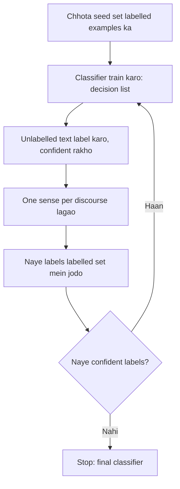

**In simple words:** thode labelled examples se shuru karo, computer ko khud aur examples label karne do, aur dohrao. Ise bootstrapping kehte hain. <Cite id="class-nlp-pyq4" loc="p. 7" />

**Definition:** Yarowsky algorithm ek semi-supervised learning approach hai jo mainly WSD ke liye use hota hai. Ye iterative, bootstrapping method hai jo thode se labelled data (seed examples) se bahut saare unlabelled data ko classify karta hai. <Cite id="class-nlp-pyq4" loc="p. 7" />

**Do principles jin par ye tikta hai** <Cite id="class-nlp-pyq4" loc="p. 7" />

1. **One sense per collocation:** jo word kisi khaas aas-paas ke word ke saath aata hai, uski har baar wahi meaning hoti hai. *Example:* "financial" ke saath "bank" strongly financial institution sense batata hai.
2. **One sense per discourse:** ek word ek hi document ya text mein lagbhag ek hi meaning rakhta hai.

**Bootstrapping process** <Cite id="class-nlp-pyq4" loc="p. 7" /> <Cite id="class-nlp-pyq4" loc="p. 8" />

1. **Initial seed examples:** har sense ke kuch haath se labelled examples. *Example:* "plant" ke liye, "manufacturing plant" sense A hai aur "plant life" sense B.
2. **Initial classification:** seeds par ek supervised model (traditionally decision list) train karo. Decision list collocation features, jaise adjacent words, ko is hisaab se rank karti hai ki wo senses ko kitna alag kar paate hain.
3. **Bootstrap labelling:** classifier se baaki unlabelled text ko label karo. Sirf wahi predictions accept karo jahan model bahut confident ho (threshold se upar).
4. **Enforce consistency:** "one sense per discourse" lagao. Agar document mein zyaadatar instances ek sense ke hain, to us document ke saare instances ko wahi sense de do.
5. **Iteration and refinement:** naye confident examples ko seed set mein jodo, retrain karo, aur dohrao. Har round mein classifier zyaada reliable hota hai.
6. **Convergence:** tab ruko jab labelling stable ho jaye aur koi naya example confidently classify na ho, ya kaafi examples label ho jayein.

**Advantages** <Cite id="class-nlp-pyq4" loc="p. 8" />

1. **Kam labelling effort:** sirf chhota haath se labelled seed set chahiye.
2. **Homographs par high accuracy:** coarse senses, jaise plant (factory) versus plant (life), par 95 percent se upar.
3. **Knowledge acquisition automate:** labelled data apne aap badhakar knowledge acquisition bottleneck kam karta hai.
4. **Flexible base learner:** decision list ki jagah doosre supervised learners use ho sakte hain.

**Disadvantages** <Cite id="class-nlp-pyq4" loc="p. 8" /> <Cite id="class-nlp-pyq4" loc="p. 9" />

1. **Domain dependence:** topics ya domains badlein to performance gir sakti hai.
2. **Seeds par sensitive:** kharab seeds errors failate hain.
3. **Mathematical limitations:** ise bahut time tak mathematically achhe se samjha nahi gaya, co-training ke ulte.
4. **Fine-grained senses:** subtle senses par ye homograph-level se kam effective hai.

**Conclusion:** Yarowsky ka method do principles se chhote seed set ko bade labelled set mein badalta hai, kam manual kaam ke saath.
