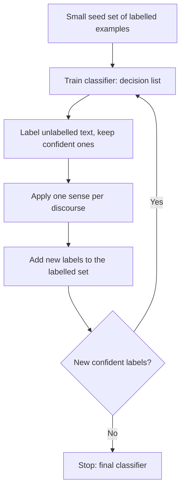

**In simple words:** start with a few labelled examples, let the computer label more examples by itself, and repeat. This is bootstrapping. <Cite id="class-nlp-pyq4" loc="p. 7" />

**Definition:** the Yarowsky algorithm is a semi-supervised learning approach used mainly for WSD. It is an iterative, bootstrapping method that uses a small set of labelled data (seed examples) to classify a large amount of unlabelled data. <Cite id="class-nlp-pyq4" loc="p. 7" />

**Two principles it relies on** <Cite id="class-nlp-pyq4" loc="p. 7" />

1. **One sense per collocation:** a word that appears with a specific nearby word tends to have the same meaning every time. *Example:* "financial" together with "bank" strongly suggests the financial institution sense.
2. **One sense per discourse:** a word tends to have only one meaning within a single document or text.

**The bootstrapping process** <Cite id="class-nlp-pyq4" loc="p. 7" /> <Cite id="class-nlp-pyq4" loc="p. 8" />

1. **Initial seed examples:** a few hand-labelled examples for each sense. *Example:* for "plant", "manufacturing plant" is sense A and "plant life" is sense B.
2. **Initial classification:** train a supervised model (traditionally a decision list) on the seeds. The decision list ranks collocation features, such as adjacent words, by how well they separate the senses.
3. **Bootstrap labelling:** use the classifier to label the rest of the unlabelled text. Accept only predictions where the model is highly confident (above a threshold).
4. **Enforce consistency:** apply "one sense per discourse". If most instances in a document have one sense, relabel all instances in that document with it.
5. **Iteration and refinement:** add the new confident examples to the seed set, retrain, and repeat. Each round the classifier gets more reliable.
6. **Convergence:** stop when labelling stabilizes and no new examples are classified confidently, or enough examples are labelled.

**Advantages** <Cite id="class-nlp-pyq4" loc="p. 8" />

1. **Reduced labelling effort:** only a small hand-labelled seed set is needed.
2. **High accuracy on homographs:** above 95 percent for coarse senses such as plant (factory) versus plant (life).
3. **Automates knowledge acquisition:** it reduces the knowledge acquisition bottleneck by expanding the labelled data automatically.
4. **Flexible base learner:** other supervised learners can replace the decision list.

**Disadvantages** <Cite id="class-nlp-pyq4" loc="p. 8" /> <Cite id="class-nlp-pyq4" loc="p. 9" />

1. **Domain dependence:** it may suffer when topics or domains vary.
2. **Sensitive to the seeds:** poor seeds spread errors.
3. **Mathematical limitations:** it was not mathematically well understood for a long time, unlike co-training.
4. **Fine-grained senses:** it is less effective for subtle senses than for homograph-level ones.

**Conclusion:** Yarowsky's method grows a small seed set into a large labelled set using the two principles, with little manual work.
